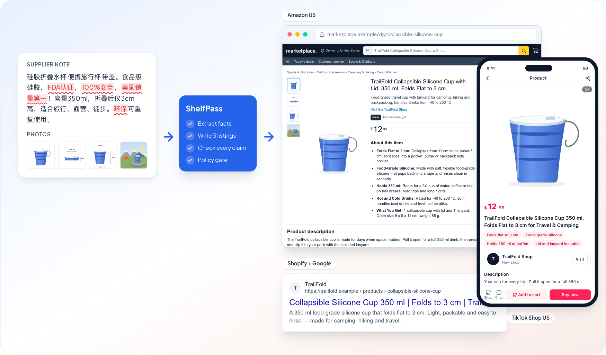
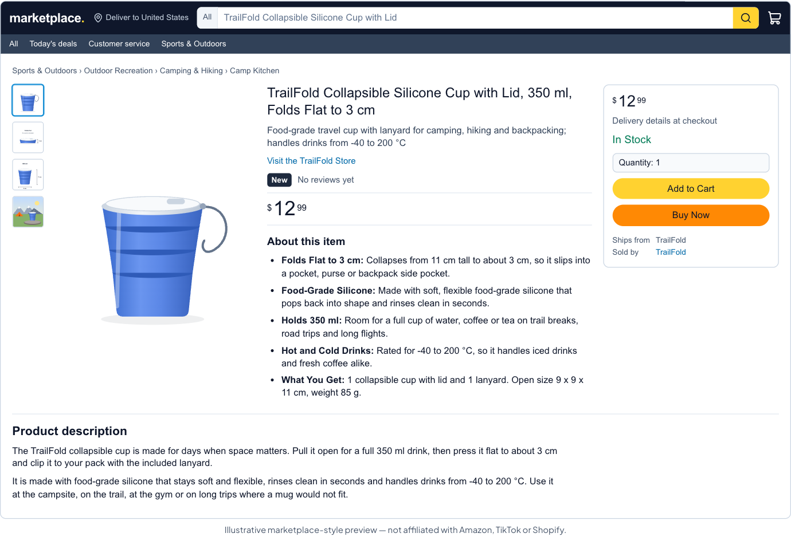
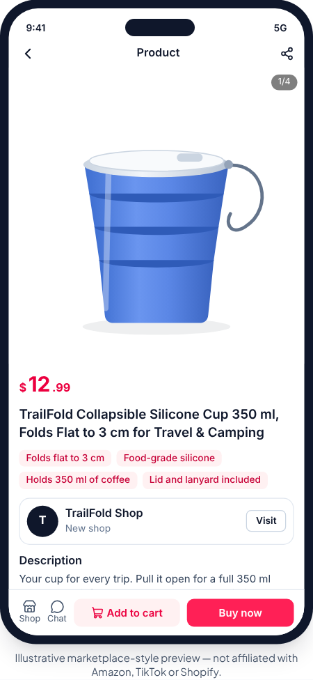
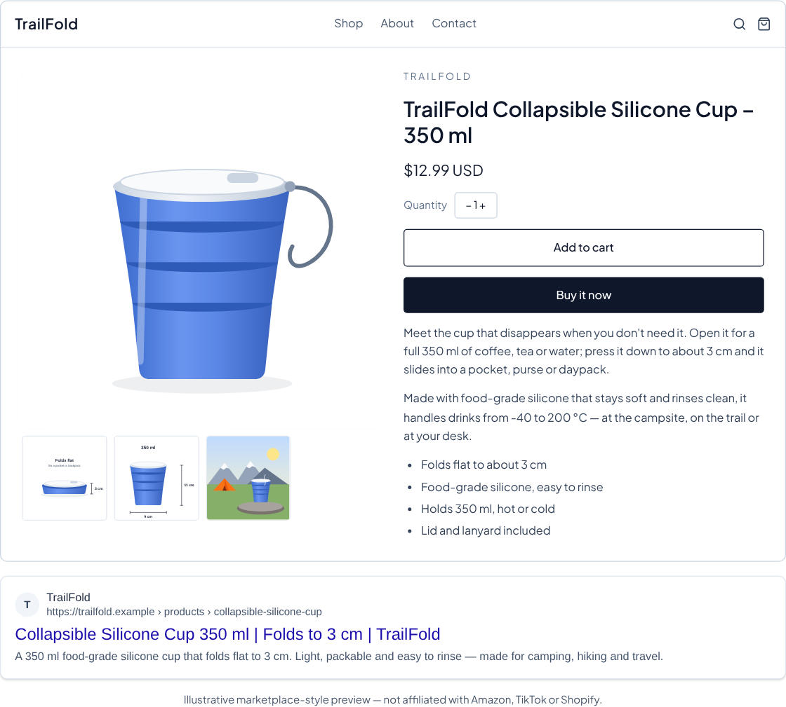
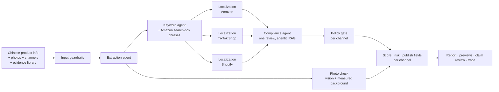

# ShelfPass

**Turn Chinese product information into one publish-ready report for Amazon US, TikTok Shop US and Shopify — then keep those listings online.**

ShelfPass is an agentic AI SaaS for cross-border sellers. A seller pastes Chinese supplier copy, like _"食品级硅胶折叠水杯，FDA认证，100%安全，美国销量第一"_ ("food-grade silicone collapsible cup, FDA certified, 100% safe, #1 seller in the US"), picks the channels they sell on and (optionally) adds up to 4 product photos. A pipeline of specialist agents then:

- extracts the facts, and asks 1–4 questions instead of guessing when there is too little to write from (no credit used)
- suggests one set of US keywords (primary, secondary, TikTok hashtags), using real phrases from Amazon's search box when they fit
- checks the photos against each site's main-image rules (the browser measures the white background; code decides) and writes a shot list
- writes one listing per channel, in parallel, each checked against that site's rules (Amazon: 75-character titles plus the 125-character Item Highlights line, in force since July 27, 2026)
- verifies every marketing claim once, across all channels, against the seller's evidence and a cited policy knowledge base, and flags any number the seller never gave (an invented spec)
- maps each listing onto the site's own "add product" form, field by field, ready to copy
- scores each channel 0–100 for quality and gives it a 0–100 takedown-risk score

Around the core report, a **compliance suite** (merged from the team's Listing Copilot prototype, D-016):

- **Audit a live listing:** paste it, get the risky claims with citations, the smallest fix, and risk and quality before → after.
- **Takedown & appeal help:** paste the marketplace's notice, get the likely cause, what to change, which documents help, and a short appeal letter in English.
- **Evidence library:** store the test reports and certificates you hold; a claim stays in a listing only when a document backs it.
- **Explain in Chinese:** a plain-language summary, a back-translation and a note per claim, in 简体中文 (free).
- **Marketplace-style previews:** see each channel's copy in an Amazon-style page, a TikTok Shop-style phone page and a Google result for a Shopify store.

The output is a report, not a live publish: every field of each form with a copy button, CSV/TXT per channel, all fields as JSON, a Markdown report and a printable page (print to PDF). Publishing through the marketplace APIs is future work ([API setup](docs/API_SETUP.md#later-direct-publishing-apis-not-in-the-capstone)). The interface is in English and 简体中文 (D-018).

UCLA _440 Building LLM Applications_ capstone.

> **Live demo:** **https://shelfpass.vercel.app** (Stripe in test mode: card `4242 4242 4242 4242`). · **Docs:** [PRD](docs/PRD.md) · [Architecture](docs/ARCHITECTURE.md) · [Agent design](docs/AGENT_DESIGN.md) · [Guardrails](docs/GUARDRAILS.md) · [Evals](docs/EVALS.md) · [Setup](docs/SETUP.md) · [Auth setup](docs/AUTH_SETUP.md) · [Team guide](docs/team/TEAM_GUIDE.md)



|                                                                      |                                                                         |                                                                                  |
| -------------------------------------------------------------------- | ----------------------------------------------------------------------- | -------------------------------------------------------------------------------- |
|  |  |  |
| Amazon-style preview                                                 | TikTok Shop-style preview                                               | Shopify + Google preview                                                         |

_Previews are illustrative marketplace-style pages, not affiliated with Amazon, TikTok or Shopify._


## Why not just ChatGPT?

ChatGPT translates "FDA认证" into "FDA Approved", which is a misleading claim on a US listing. ShelfPass adds what a chat window doesn't have:

|                                                                           | ChatGPT    | ShelfPass                                                                                                        |
| ------------------------------------------------------------------------- | ---------- | ---------------------------------------------------------------------------------------------------------------- |
| Platform rules (75-char titles, banned characters, 249-byte search terms) | —          | One rule engine per channel that the agent must pass, rewriting rather than truncating                           |
| Each site's own form                                                      | —          | Every field of the Amazon / TikTok Shop / Shopify "add product" form, in order, with copy buttons                |
| Photos                                                                    | —          | Main-image check per channel (measured white background, text, watermark, fill) plus a shot list                 |
| Claim verification                                                        | —          | Each claim marked verified, unverified or restricted, with a policy citation and a suggested fix                 |
| Safety net                                                                | —          | Deterministic lexicon and an output policy gate: restricted phrases cannot reach the final listing               |
| Evidence                                                                  | —          | A document library; a claim stays only when a document the seller holds backs it                                 |
| A listing that is already live                                            | —          | Audit: findings with citations, the smallest fix (untouched fields stay identical), risk before → after          |
| A takedown notice                                                         | —          | Cause, fix steps, documents to gather and an English appeal letter, citing only policies it actually retrieved   |
| Quality and risk you can measure                                          | —          | 0–100 quality score (rules + LLM judge) and 0–100 takedown-risk score (code), before vs after                    |
| Workflow                                                                  | copy-paste | Edit per channel with re-check, previews, printable report, CSV/TXT/JSON/MD export, history, full trace, 中文 UI |

## How it works



The audit and appeal tools reuse the same harness, agents and guardrails (see [Agent design](docs/AGENT_DESIGN.md#9-compliance-suite-audit-appeal-explain-risk)).

- **Stack:**
  - Next.js 16 (App Router), deployed on Vercel
  - Supabase: Postgres, Auth (email codes, phone codes), row-level security, pgvector
  - Stripe Checkout and webhooks (test mode): Pro subscription and one-time credit packs
  - Claude API through the Anthropic TypeScript SDK, with a fast tier and a smart tier
  - Design system generated with the ui-ux-pro-max skill (`design-system/shelfpass/MASTER.md`, D-017)
- **Harness:** structured outputs plus zod contracts, a ReAct tool loop driven by `stop_reason`, per-run budgets (calls, tokens, cost, time), tracing of every model and tool call, and PII redaction.
- **Trust:** three guardrail layers (input incl. a photo file check, actions, output gate per channel) and eval suites: 14 golden report cases scored on outcome, process, output contract and efficiency for every channel; 6 audit cases; 4 appeal cases; retrieval metrics (Recall@k, MRR, NDCG). `pnpm eval` fails below an 80% pass rate.
- **Live results** for the core report (smart and fast tiers as configured in D-015): 13/13 golden cases in two consecutive live runs on 2026-10-19 (first live baseline: 10/13), about $0.08–0.09 and 31–34 s per three-channel case; retrieval recall@3 0.93. Those runs predate the 75-character titles, the questions for thin input and number grounding (D-020–D-022), which pass every suite in mock mode (golden 14/14, audit 6/6, appeal 4/4); the live suites are re-run with the Anthropic key before the demo.


## Quick start (no API keys needed)

```bash
pnpm install
cp .env.example .env.local     # defaults = mock mode: fake agents, in-memory DB, mock billing
pnpm dev                       # http://localhost:3000 → Start free → any email → New report → Example → Generate report
```

Then try **Audit a listing**, **Takedown help** and **Evidence** from the dashboard, and switch the language to 简体中文 in the header.

```bash
pnpm check        # lint + typecheck + unit tests
pnpm eval         # golden + audit + appeal + retrieval evals
pnpm test:e2e     # Playwright: report + preview + credit pack + Pro; injection blocked; evidence + audit + appeal; Chinese UI
pnpm check:env    # verify your .env.local for the modes you enabled
```

Turn on real services one at a time with [docs/SETUP.md](docs/SETUP.md). Sign-in, email/phone verification and payment settings in the Supabase and Stripe dashboards: [docs/AUTH_SETUP.md](docs/AUTH_SETUP.md). Deploying: [docs/DEPLOYMENT.md](docs/DEPLOYMENT.md). Which key goes where: [docs/API_SETUP.md](docs/API_SETUP.md).

| Setting        | Default (`mock` / `memory` / `lexical`) | Real version        |
| -------------- | --------------------------------------- | ------------------- |
| `AI_MODE`      | `mock`                                  | `live` (Claude API) |
| `DATA_MODE`    | `memory`                                | `supabase`          |
| `BILLING_MODE` | `mock`                                  | `stripe`            |
| `RAG_MODE`     | `lexical`                               | `vector`            |

## Pricing

| Plan        | Price       | Credits                                     |
| ----------- | ----------- | ------------------------------------------- |
| Free        | $0          | 3, once                                     |
| Credit pack | $4.99, once | 20; pack credits never expire               |
| Pro         | $9.99/month | balance topped up to at least 50 each month |

One credit = one multi-channel report, one listing audit or one takedown analysis. Explanations in Chinese are free. Cancelling Pro keeps the balance. Details: [/pricing](https://shelfpass.vercel.app/pricing) and `docs/AUTH_SETUP.md` §7.

## Repository map

```
src/lib/contracts   shared zod types + ports            src/lib/harness     LLM client, tool loop, tracer, budget
src/lib/pipeline    orchestrator · audit · appeal       src/lib/agents      extraction · images · keywords · localization · compliance · judge · audit · appeal · explain
src/lib/guardrails  input screen · claim lexicon · gate src/lib/rules       per-channel rules + form fields (Amazon, TikTok Shop, Shopify)
src/lib/rag         policy retrieval                    src/lib/scoring     quality score
src/lib/report      publish fields · photo guidance · risk score · edits view · Markdown report
src/lib/evidence    evidence library → evidence text    src/lib/i18n        English / 简体中文 dictionaries
src/lib/db|auth|billing   Supabase / Stripe adapters    src/app             pages + API routes
src/components      UI kit · listing · tools · preview · marketing · auth · billing
knowledge/policies  cited compliance knowledge base     evals/              golden, audit, appeal, retrieval datasets + runner
supabase/migrations schema, RLS, credit functions       design-system/      design system (ui-ux-pro-max)
.claude/            team Claude Code setup (hooks, skills, subagents, commands)
docs/               PRD, architecture, guardrails, evals, setup, auth setup, deployment, team briefs, write-up
memory/             decisions, lessons learned, timeline
```

## Team

| Workstream       | Owns                                                            | Brief                                 |
| ---------------- | --------------------------------------------------------------- | ------------------------------------- |
| Lead             | Contracts, harness, integration, write-up, demo                 | [TEAM_GUIDE](docs/team/TEAM_GUIDE.md) |
| WS1: AI pipeline | Extraction, keywords, localization, orchestrator, report        | [ws1](docs/team/ws1-ai-pipeline.md)   |
| WS2: Trust layer | Compliance, photo check, RAG, guardrails, rules, scoring, evals | [ws2](docs/team/ws2-trust-layer.md)   |
| WS3: Product UI  | Pages, components, report UI, export, e2e tests                 | [ws3](docs/team/ws3-product-ui.md)    |
| WS4: Platform    | Auth, Supabase, Stripe, deployment                              | [ws4](docs/team/ws4-platform.md)      |

The compliance suite (audit, appeal, evidence library, risk score, explanations) is ported from a teammate's Listing Copilot prototype.

Course requirement → repo map: [docs/COURSE_REQUIREMENTS.md](docs/COURSE_REQUIREMENTS.md). Design decisions: [memory/decisions.md](memory/decisions.md).

_ShelfPass screens listings for risk using summarized policies. It is not legal advice and does not guarantee marketplace approval. Keywords are AI-suggested, not search-volume data. ShelfPass is not affiliated with Amazon, TikTok or Shopify; always check each site's current requirements before publishing._
