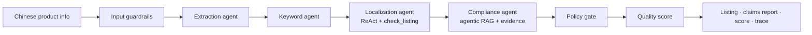

# ListWise AI

**Turn Chinese product information into localized, search-ready and compliance-reviewed Amazon US listings.**

ListWise is an agentic AI SaaS for cross-border sellers. A seller pastes Chinese supplier copy, like _"食品级硅胶折叠水杯，FDA认证，100%安全，美国销量第一"_ ("food-grade silicone collapsible cup, FDA certified, 100% safe, #1 seller in the US"). A pipeline of specialist agents then:

- extracts the facts
- suggests US keywords
- writes a platform-compliant listing that it checks against the marketplace rules
- verifies every marketing claim against the seller's evidence and a cited policy knowledge base
- scores the result 0–100, side by side with the seller's current listing

UCLA _440 Building LLM Applications_ capstone.

> **Live demo:** _coming in week 3 (Vercel)_ · **Docs:** [PRD](docs/PRD.md) · [Architecture](docs/ARCHITECTURE.md) · [Agent design](docs/AGENT_DESIGN.md) · [Guardrails](docs/GUARDRAILS.md) · [Evals](docs/EVALS.md) · [Setup](docs/SETUP.md) · [Team guide](docs/team/TEAM_GUIDE.md)


## Why not just ChatGPT?

ChatGPT translates "FDA认证" into "FDA Approved", which is a misleading claim on a US listing. ListWise adds what a chat window doesn't have:

|                                                                            | ChatGPT    | ListWise                                                                                           |
| -------------------------------------------------------------------------- | ---------- | -------------------------------------------------------------------------------------------------- |
| Platform rules (200-char titles, banned characters, 249-byte search terms) | —          | Rule engine the agent must pass, rewriting rather than truncating                                  |
| Claim verification                                                         | —          | Each claim marked verified, unverified or restricted, with a policy citation and a suggested fix   |
| Safety net                                                                 | —          | Deterministic lexicon and an output policy gate: restricted phrases cannot reach the final listing |
| Quality you can measure                                                    | —          | 0–100 score (rules + LLM judge), before vs after                                                   |
| Workflow                                                                   | copy-paste | Edit with re-check, export CSV/TXT/JSON, history, trace of every agent step                        |

## How it works



- **Stack:**
  - Next.js 16 (App Router), deployed on Vercel
  - Supabase: Postgres, Auth, row-level security, pgvector
  - Stripe Checkout and webhooks (test mode)
  - Claude API through the Anthropic TypeScript SDK, with a fast tier and a smart tier
- **Harness:** structured outputs plus zod contracts, a ReAct tool loop driven by `stop_reason`, per-run budgets (calls, tokens, cost, time), tracing of every model and tool call, and PII redaction.
- **Trust:** three guardrail layers (input, actions, output) and an eval suite of golden cases scored on outcome, process, output contract and efficiency, plus retrieval metrics (Recall@k, MRR, NDCG). Merging is blocked below 80% pass rate.


## Quick start (no API keys needed)

```bash
pnpm install
cp .env.example .env.local     # defaults = mock mode: fake agents, in-memory DB, mock billing
pnpm dev                       # http://localhost:3000 → Sign in with any email → New listing → Example
```

```bash
pnpm check        # lint + typecheck + unit tests
pnpm eval         # golden + retrieval evals
pnpm test:e2e     # Playwright smoke test of the full journey
pnpm check:env    # verify your .env.local for the modes you enabled
```

Turn on real services one at a time with the guide in [docs/SETUP.md](docs/SETUP.md):

| Setting        | Default (`mock` / `memory` / `lexical`) | Real version        |
| -------------- | --------------------------------------- | ------------------- |
| `AI_MODE`      | `mock`                                  | `live` (Claude API) |
| `DATA_MODE`    | `memory`                                | `supabase`          |
| `BILLING_MODE` | `mock`                                  | `stripe`            |
| `RAG_MODE`     | `lexical`                               | `vector`            |

## Repository map

```
src/lib/contracts   shared zod types + ports            src/lib/harness     LLM client, tool loop, tracer, budget
src/lib/pipeline    orchestrator                        src/lib/agents      extraction · keywords · localization · compliance · judge
src/lib/guardrails  input screen · claim lexicon · gate src/lib/rules       platform rule engine
src/lib/rag         policy retrieval                    src/lib/scoring     quality score
src/lib/db|auth|billing   Supabase / Stripe adapters    src/app             pages + API routes
knowledge/policies  cited compliance knowledge base     evals/              golden + retrieval datasets, runner
supabase/migrations schema, RLS, credit functions       .claude/            team Claude Code setup (hooks, skills, subagents, commands)
docs/               PRD, architecture, guardrails, evals, setup, deployment, team briefs, write-up
memory/             decisions, lessons learned, timeline
```

## Team

| Workstream       | Owns                                                     | Brief                                 |
| ---------------- | -------------------------------------------------------- | ------------------------------------- |
| Lead             | Contracts, harness, integration, write-up, demo          | [TEAM_GUIDE](docs/team/TEAM_GUIDE.md) |
| WS1: AI pipeline | Extraction, keywords, localization, orchestrator         | [ws1](docs/team/ws1-ai-pipeline.md)   |
| WS2: Trust layer | Compliance agent, RAG, guardrails, rules, scoring, evals | [ws2](docs/team/ws2-trust-layer.md)   |
| WS3: Product UI  | Pages, components, export, e2e tests                     | [ws3](docs/team/ws3-product-ui.md)    |
| WS4: Platform    | Auth, Supabase, Stripe, deployment                       | [ws4](docs/team/ws4-platform.md)      |

Course requirement → repo map: [docs/COURSE_REQUIREMENTS.md](docs/COURSE_REQUIREMENTS.md). Design decisions: [memory/decisions.md](memory/decisions.md).

_ListWise screens listings for risk using summarized policies. It is not legal advice and does not guarantee marketplace approval. Keywords are AI-suggested, not search-volume data._
