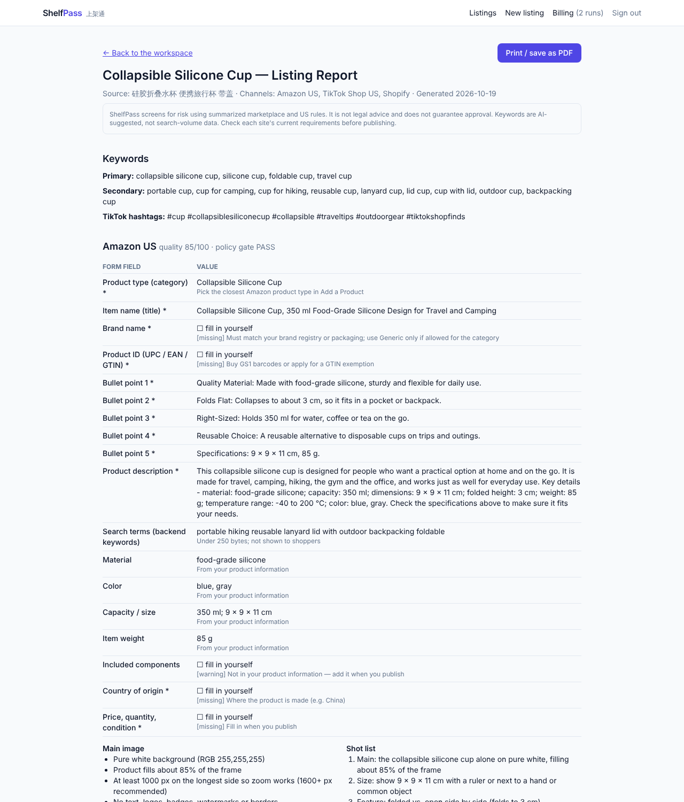
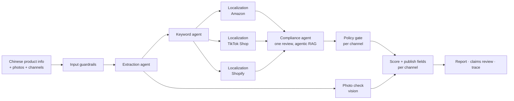
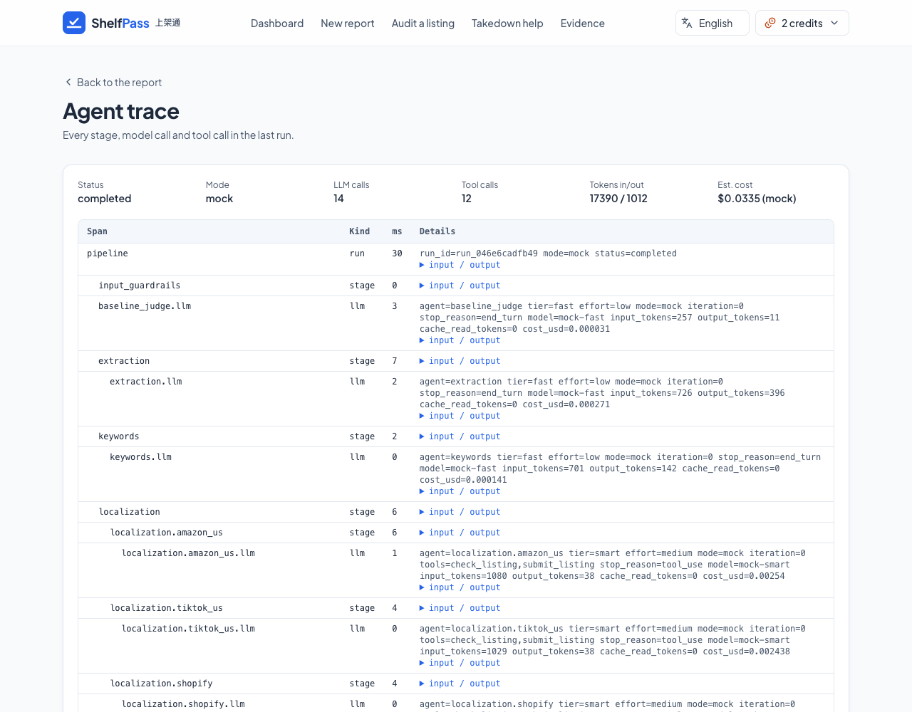

# ShelfPass

**Turn Chinese product information into one publish-ready report for Amazon US, TikTok Shop US and Shopify.**

ShelfPass is an agentic AI SaaS for cross-border sellers. A seller pastes Chinese supplier copy, like _"食品级硅胶折叠水杯，FDA认证，100%安全，美国销量第一"_ ("food-grade silicone collapsible cup, FDA certified, 100% safe, #1 seller in the US"), picks the channels they sell on and (optionally) adds up to 4 product photos. A pipeline of specialist agents then:

- extracts the facts
- suggests one set of US keywords (primary, secondary, TikTok hashtags)
- checks the photos against each site's main-image rules and writes a shot list
- writes one listing per channel, in parallel, each checked against that site's rules
- verifies every marketing claim once, across all channels, against the seller's evidence and a cited policy knowledge base
- maps each listing onto the site's own "add product" form, field by field, ready to copy
- scores each channel 0–100, side by side with the seller's current listing

The output is a report, not a live publish: every field of each form with a copy button, CSV/TXT per channel, all fields as JSON, a Markdown report and a printable page (print to PDF). Publishing directly through the marketplace APIs is future work (see [API setup](docs/API_SETUP.md#later-direct-publishing-apis-not-in-the-capstone)).

UCLA _440 Building LLM Applications_ capstone.

> **Live demo:** **https://shelfpass.vercel.app** (Stripe in test mode: card `4242 4242 4242 4242`) · **Docs:** [PRD](docs/PRD.md) · [Architecture](docs/ARCHITECTURE.md) · [Agent design](docs/AGENT_DESIGN.md) · [Guardrails](docs/GUARDRAILS.md) · [Evals](docs/EVALS.md) · [Setup](docs/SETUP.md) · [Team guide](docs/team/TEAM_GUIDE.md)




## Why not just ChatGPT?

ChatGPT translates "FDA认证" into "FDA Approved", which is a misleading claim on a US listing. ShelfPass adds what a chat window doesn't have:

|                                                                            | ChatGPT    | ShelfPass                                                                                          |
| -------------------------------------------------------------------------- | ---------- | -------------------------------------------------------------------------------------------------- |
| Platform rules (200-char titles, banned characters, 249-byte search terms) | —          | One rule engine per channel that the agent must pass, rewriting rather than truncating             |
| Each site's own form                                                       | —          | Every field of the Amazon / TikTok Shop / Shopify "add product" form, in order, with copy buttons  |
| Photos                                                                     | —          | Main-image check per channel (background, text, watermark, fill) plus a shot list                  |
| Claim verification                                                         | —          | Each claim marked verified, unverified or restricted, with a policy citation and a suggested fix   |
| Safety net                                                                 | —          | Deterministic lexicon and an output policy gate: restricted phrases cannot reach the final listing |
| Quality you can measure                                                    | —          | 0–100 score (rules + LLM judge), before vs after                                                   |
| Workflow                                                                   | copy-paste | Edit per channel with re-check, printable report, CSV/TXT/JSON/MD export, history, full trace      |

## How it works



- **Stack:**
  - Next.js 16 (App Router), deployed on Vercel
  - Supabase: Postgres, Auth, row-level security, pgvector
  - Stripe Checkout and webhooks (test mode)
  - Claude API through the Anthropic TypeScript SDK, with a fast tier and a smart tier
- **Harness:** structured outputs plus zod contracts, a ReAct tool loop driven by `stop_reason`, per-run budgets (calls, tokens, cost, time), tracing of every model and tool call, and PII redaction.
- **Trust:** three guardrail layers (input incl. a photo file check, actions, output gate per channel) and an eval suite of 13 golden cases scored on outcome, process, output contract and efficiency for every channel, plus retrieval metrics (Recall@k, MRR, NDCG). Merging is blocked below 80% pass rate.
- **Live results** (`claude-sonnet-5-5` smart, `claude-haiku-5-5` fast): 13/13 golden cases in two consecutive live runs (first live baseline: 10/13), about $0.08–0.09 and 31–34 s per three-channel case; retrieval recall@3 0.93.



## Quick start (no API keys needed)

```bash
pnpm install
cp .env.example .env.local     # defaults = mock mode: fake agents, in-memory DB, mock billing
pnpm dev                       # http://localhost:3000 → Sign in with any email → New listing → Example → Generate report
```

```bash
pnpm check        # lint + typecheck + unit tests
pnpm eval         # golden + retrieval evals
pnpm test:e2e     # Playwright smoke test of the full journey
pnpm check:env    # verify your .env.local for the modes you enabled
```

Turn on real services one at a time with the guide in [docs/SETUP.md](docs/SETUP.md). Deploying: [docs/DEPLOYMENT.md](docs/DEPLOYMENT.md). Which key goes where: [docs/API_SETUP.md](docs/API_SETUP.md) (in short: Vercel → Project → Settings → Environment Variables, then redeploy).

| Setting        | Default (`mock` / `memory` / `lexical`) | Real version        |
| -------------- | --------------------------------------- | ------------------- |
| `AI_MODE`      | `mock`                                  | `live` (Claude API) |
| `DATA_MODE`    | `memory`                                | `supabase`          |
| `BILLING_MODE` | `mock`                                  | `stripe`            |
| `RAG_MODE`     | `lexical`                               | `vector`            |

## Repository map

```
src/lib/contracts   shared zod types + ports            src/lib/harness     LLM client, tool loop, tracer, budget
src/lib/pipeline    orchestrator                        src/lib/agents      extraction · images · keywords · localization · compliance · judge
src/lib/guardrails  input screen · claim lexicon · gate src/lib/rules       per-channel rules + form fields (Amazon, TikTok Shop, Shopify)
src/lib/rag         policy retrieval                    src/lib/scoring     quality score
src/lib/report      publish fields · photo guidance · edits view · Markdown report
src/lib/db|auth|billing   Supabase / Stripe adapters    src/app             pages + API routes
knowledge/policies  cited compliance knowledge base     evals/              golden + retrieval datasets, runner
supabase/migrations schema, RLS, credit functions       .claude/            team Claude Code setup (hooks, skills, subagents, commands)
docs/               PRD, architecture, guardrails, evals, setup, deployment, team briefs, write-up
memory/             decisions, lessons learned, timeline
```

## Team

| Workstream       | Owns                                                            | Brief                                 |
| ---------------- | --------------------------------------------------------------- | ------------------------------------- |
| Lead             | Contracts, harness, integration, write-up, demo                 | [TEAM_GUIDE](docs/team/TEAM_GUIDE.md) |
| WS1: AI pipeline | Extraction, keywords, localization, orchestrator, report        | [ws1](docs/team/ws1-ai-pipeline.md)   |
| WS2: Trust layer | Compliance, photo check, RAG, guardrails, rules, scoring, evals | [ws2](docs/team/ws2-trust-layer.md)   |
| WS3: Product UI  | Pages, components, report UI, export, e2e tests                 | [ws3](docs/team/ws3-product-ui.md)    |
| WS4: Platform    | Auth, Supabase, Stripe, deployment                              | [ws4](docs/team/ws4-platform.md)      |

Course requirement → repo map: [docs/COURSE_REQUIREMENTS.md](docs/COURSE_REQUIREMENTS.md). Design decisions: [memory/decisions.md](memory/decisions.md).

_ShelfPass screens listings for risk using summarized policies. It is not legal advice and does not guarantee marketplace approval. Keywords are AI-suggested, not search-volume data. ShelfPass is not affiliated with Amazon, TikTok or Shopify; always check each site's current requirements before publishing._
