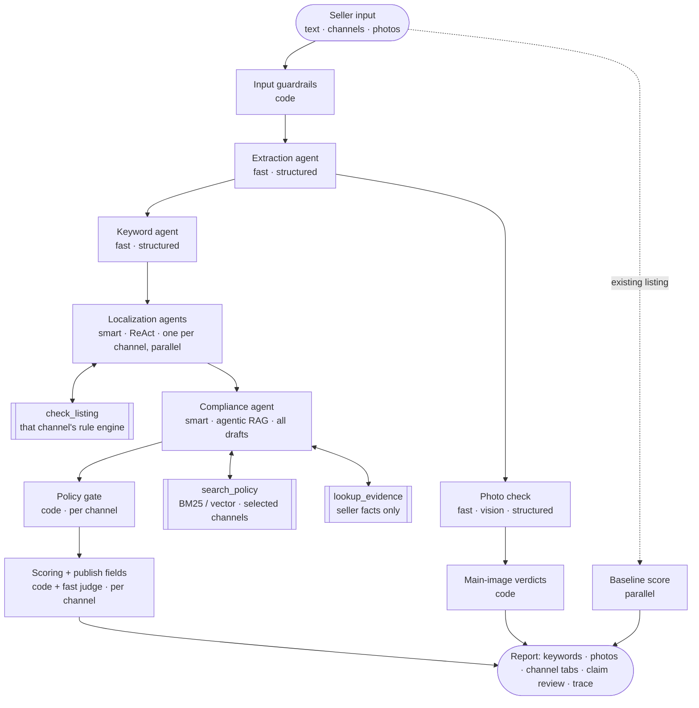

# Agent design

How the AI backend works, stage by stage, and how it maps onto the course concepts (LLM → agent → harness → product). §1–8 cover the core report; §9 covers the compliance suite (audit, appeal, explanations, risk score) merged from the team's Listing Copilot prototype (D-016).

## 1. The harness (course Module 1)

The model is one component; the harness around it is what makes it a product. Everything in `src/lib/harness`:

| Harness building block   | ShelfPass implementation                                                                                                                                                                                    |
| ------------------------ | ----------------------------------------------------------------------------------------------------------------------------------------------------------------------------------------------------------- |
| **Tools**                | `defineTool()` — zod-validated input, per-run call caps, spans per call (`tool-loop.ts`)                                                                                                                    |
| **Memory / context**     | Each agent "wakes up empty": the orchestrator packs exactly the context it needs (facts, keywords, drafts, evidence, photos). No shared chat history between agents.                                        |
| **Planning**             | Fixed stage order in the orchestrator; inside the two agentic stages the model plans its own tool calls (ReAct). Independent work runs in parallel (photos ‖ keywords; one localization agent per channel). |
| **Execution**            | `callModel()` (budget check → call → charge → trace), `structuredCall()`, `runToolLoop()`                                                                                                                   |
| **Rules / instructions** | System prompts in `agents/*/prompt.ts`, output contracts in `contracts/`, guardrails in code                                                                                                                |

The agentic loop trusts only `stop_reason`: `tool_use` → execute tools and continue; a final "submit" tool call → validate and return; anything else → one nudge, then fail with `max_iterations`. A turn-budget note forces a best-effort answer on the last turn ("return a partial answer with clear boundaries").

## 2. Hub and spoke

The orchestrator is the hub. Specialists never talk to each other (no peer-to-peer), which keeps each one testable with a fixed input and output contract. Only two stages are agentic, because only they benefit from choosing their own next step; counting, validation, credits, the final gate and the field mapping are plain code.

Why one localization agent per channel but one compliance review: each channel has its own style and limits, so each draft gets its own loop and its own `check_listing` tool built from that channel's rules; the three run in parallel, each in its own trace span. A claim, though, is the same claim on every channel ("FDA approved" is misleading on Amazon and on Shopify), so the compliance agent reviews all drafts at once, assesses each phrase once, and the gate applies that verdict wherever the phrase appears. A typical three-channel run is about 13 model calls (mock mode: extraction 1, keywords 1, localization 3 × 2, compliance 2, judge 3, baseline 1, plus 1 for photos when uploaded).

## 3. Agent cards

### Extraction — `agents/extraction` (WS1)

- **Job:** Chinese text → `ProductFacts` (facts with verbatim source quotes, marketing claims kept separate, missing info).
- **Tier / effort:** fast / low. **Pattern:** single structured call (`output_config.format` from zod).
- **Guardrails:** seller text wrapped in `<seller_input>`; _grounding check_ in code downgrades any fact whose quote is not in the input.
- **Too thin to write from (D-021):** code (`extraction/sufficiency.ts`) requires a product type plus at least one stated material, size or concrete feature. Otherwise the run stops with `needs_info` (credit refunded) and the seller gets 1–4 questions in English and Chinese; the model only phrases them (`ProductFacts.questions`), and it cannot stop a run that has enough facts.
- **Failure modes:** invents specs (caught by grounding check); treats claims as facts (golden `must_flag` cases); writes from too little (golden `thin-input-asks-questions`).

### Keywords — `agents/keywords` (WS1)

- **Job:** facts → one `KeywordSet` for every selected channel (3–5 primary, 5–15 secondary, 4–8 TikTok hashtags). Always labeled **AI-suggested**: we have no search-volume data.
- **Tier / effort:** fast / low. **Post-processing in code:** lowercase, dedupe, drop promotional words; hashtags lose `#` and spaces.
- **Real shopper phrases** (`keywords/suggest.ts`, ported from Listing Copilot): in live mode, when Amazon US is selected, up to 3 seeds go to Amazon's public search-box suggestion endpoint (2.5 s timeout; any failure returns nothing and the run continues). The phrases reach the model as data inside tags, never as instructions. Code, not the model, fills `from_search_box` with the final keywords that exactly match a phrase; the UI badges them "Seen in Amazon's search box". Mock mode and tests never call the network (tests inject a fake `suggest`).

### Photo check — `agents/images` (WS2)

- **Job:** up to 4 seller photos → `ImageAnalysis` (per photo: what it shows, background pure white / light plain / busy, text or logo, watermark, product fill, props, quality issues, alt text; suggested main photo).
- **Tier / effort:** fast / low. **Pattern:** single structured call with image blocks. Runs only when photos were uploaded, in parallel with keywords.
- **The model describes; code decides.** `report/images.ts` turns observations into a main-image verdict per channel (Amazon needs pure white, no text, no props; TikTok and Shopify are looser) and builds each channel's rules, gallery guidance and shot list from the facts.
- **Measured background** (ported from Listing Copilot): the browser counts near-white pixels on the outer 4% of each photo before resizing and sends `white_ratio`. The photo check gets it as a `<measurement>` to trust over its impression, and `applyWhiteMeasurement` uses it in code: ≥ 97% white border passes Amazon's pure-white rule; below that, the verdict states the measured percentage. This works in mock mode too, because it needs no model.
- **Guardrails:** photo bytes are checked against the declared type before any call; file names are sanitized; the prompt says text inside photos is data. Photo bytes are left out of traces. Mock mode cannot see pixels and says so.

### Localization — `agents/localization` (WS1)

- **Job:** facts + keywords → one `ListingDraft` per selected channel that passes that channel's rule engine. Fields: title, bullets (Amazon bullet points / TikTok selling points / Shopify highlights), description, `search_terms` (Amazon only), `seo_title` + `seo_description` (Shopify only), `tags` (TikTok hashtags / Shopify tags). Unused fields stay empty.
- **Tier / effort:** smart / medium. **Pattern:** ReAct loop, ≤ 6 turns, one loop per channel, run in parallel.
- **Tools:** `check_listing` (≤ 4 calls) runs `validateListing(draft, platform)` + the claim lexicon and returns violations; final tool `submit_listing` (strict schema).
- **Rule:** rewrite, never truncate. The prompt's channel section (limits and style) is generated from the same config the validator uses (`rules/amazon-us.ts`, `tiktok-us.ts`, `shopify.ts`), so they cannot drift.

### Compliance — `agents/compliance` (WS2)

- **Job:** every seller claim and every claim-like phrase in any channel's draft → `ClaimAssessment` (verified / unverified / restricted, risk, action, suggested fix, evidence ids, policy citations). One review covers all drafts; the same phrase is assessed once.
- **Tier / effort:** smart / medium. **Pattern:** agentic RAG, ≤ 6 turns.
- **Tools:** `search_policy` (≤ 4 calls — the course's classroom budget; filtered to policies for the selected channels plus general US rules), `lookup_evidence` (≤ 8; authorization in code: it can only read _this_ seller's facts and evidence).
- **Stopping rules (in the prompt):** all claims assessed → submit; searches stop adding evidence → state the gap; tool failure / conflict → note in `uncertainty`.
- **Post-processing in code:** _citation integrity_ (drop any policy reference that was not actually retrieved in this run) and _lexicon backstop_ (add any risky draft phrase the agent missed).

### Policy gate — `guardrails/gate.ts` (WS2, code)

Runs once per channel. Applies rewrite/remove actions wherever the phrase appears (title, Item Highlights, bullets, description, search terms, SEO title and description, tags), then sweeps every field with the lexicon until nothing restricted remains, re-validates that channel's rules (Amazon: 75-character title and 125-character Item Highlights, D-020), and returns PASS/FAIL plus a needs-review list: unverified claims the seller must confirm, and any number that is neither in the seller's text nor a unit conversion of it (number grounding, D-022).

### Report builder — `report/` (WS1, code)

- `fields.ts` maps each gated listing onto that site's "add product" form, field by field and in order (from `rules/*.ts` `form`): each field is _generated_ (from the listing), _fact_ (from the seller's input, e.g. brand, material, weight) or _seller_ (only the seller can fill it, e.g. UPC, price), with status ok / warning / missing and the validator's message as a note.
- `images.ts` builds main-image verdicts (incl. the measured white border) and per-channel photo guidance.
- `risk.ts` computes each channel's takedown-risk score (§9).
- `view.ts` (`channelViews`) is the one read path for the UI, the printable report and exports: a channel with seller edits is re-validated, re-screened and re-mapped in code, so an edit can never skip the checks.
- `markdown.ts` renders the downloadable report.

### Quality judge — `agents/judge` (WS2)

- **Job:** language naturalness and clarity, 1–5 each, with an anchored rubric — the one score dimension code cannot measure. Fast tier, low effort. Runs once per channel. Also scores the seller's existing listing for the before/after comparison (runs in parallel, against the first selected channel's rules).

### Scoring — `scoring/score.ts` (WS2, code)

| Dimension            | Weight | How                                                                                                              |
| -------------------- | ------ | ---------------------------------------------------------------------------------------------------------------- |
| Keyword relevance    | 25     | Primary keywords in title (50%) and body (30%), secondary coverage incl. search terms, SEO fields and tags (20%) |
| Information coverage | 25     | Share of medium/high-confidence facts present; −5 per missing buyer-critical attribute (max −20)                 |
| Language naturalness | 20     | Judge: 70% naturalness + 30% clarity                                                                             |
| Claim verification   | 20     | 100 − 35 per restricted − 10 per unverified claim left − 5 per claim awaiting seller evidence                    |
| Format compliance    | 10     | 100 − 25 per rule error − 5 per warning                                                                          |

Each channel gets its own score. The score is a quality signal, not a conversion prediction; the UI says so.

## 4. Embedded rubrics (course Module 2)

Every agent prompt ends with a self-check over the four dimensions — **scope** (only what was asked), **citation** (facts quote sources / claims cite retrieved policy), **uncertainty** (gaps stated, "couldn't verify X" is a valid answer), **format** (contract followed). The external check is the eval suite (`docs/EVALS.md`).

## 5. Skills → server translation (course Module 4)

| In Claude Code (dev harness)                                  | On the server (product)                                  |
| ------------------------------------------------------------- | -------------------------------------------------------- |
| `.claude/skills/listing-localizer/SKILL.md` step instructions | `src/lib/agents/*/prompt.ts` system prompts              |
| Tools the skill uses by hand                                  | `tools` arrays built by `runToolLoop()` from zod schemas |
| Skill calls skill                                             | `src/lib/pipeline/orchestrator.ts`                       |
| Output format in the skill                                    | zod contracts → structured outputs / strict tools        |

Iterate on a prompt with the skill (it reads the same prompt files), then confirm with `pnpm eval`.

## 6. Models and cost

Two tiers, set by env (`ANTHROPIC_MODEL_SMART`, `ANTHROPIC_MODEL_FAST`) — copy current IDs from the Anthropic models overview page (see `docs/SETUP.md`). Smart: localization, compliance, audit fix, appeal. Fast: extraction, photo check, keywords, judge, explanations, structuring a messy audit paste. Prices for the trace's cost column come from env as well. System prompts are sent with `cache_control` so repeated runs hit the prompt cache (watch `cache_read_tokens` in traces).

Per-run budget (`harness/budget.ts`): 40 calls · 400k tokens · $1.50 · 240 s. Typical mock run for three channels: about 13 calls. Measure live cost per run in traces before changing the Pro cap.

## 7. Adding a channel (e.g. Walmart)

1. Add `src/lib/rules/<channel>.ts` with limits, style, banned phrases, main-image rules and the `form` field list; register it in `registry.ts` and add the id to `PLATFORMS` in contracts (lead) (WS2).
2. Add any channel-specific policy docs to `knowledge/policies` with `platforms: [<channel>]` (WS2).
3. Add the checkbox in the form (WS3) and golden cases with `"platforms": ["<channel>"]` (WS1/WS2).
   No new agent is needed: the localization prompt, `check_listing`, the gate, the publish fields and the photo guidance are all generated from the rule config — that is the point of the design.

## 8. Not built: direct publishing

The report stops at "every field, ready to paste". Publishing through Amazon SP-API, the TikTok Shop Partner API or the Shopify Admin API needs developer registration, app review and per-seller authorization that take longer than the capstone's one week. The `fields` contract (form key → value) is what a future publisher would send; see `docs/API_SETUP.md`.

## 9. Compliance suite: audit, appeal, explain, risk

Features merged from the team's Listing Copilot prototype, rebuilt on this harness (tracer, budget, mocks, guardrails) instead of a second AI stack (D-016). Code: `src/lib/agents/{audit,appeal,explain}`, `src/lib/pipeline/{audit,appeal,tool-run,tool-route}.ts`, `src/lib/report/risk.ts`, `src/lib/evidence`.

### Takedown-risk score — `report/risk.ts` (code)

- Deterministic, 0–100, computed from what is still in the copy: lexicon hits (restricted +40, unproven +10 / +18), compliance findings still present, rule errors (+10 each, cap 30), warnings (+2, cap 8), untranslated Chinese (+15). Floors: any restricted claim ⇒ ≥ 60 (high); any unproven claim ⇒ ≥ 25 (medium). Levels: < 20 low, < 50 medium, else high.
- Added to every `ChannelView` (generated and edited copy) and shown as a badge with reasons on each channel tab. Same input ⇒ same score, so before/after comparisons and evals are reproducible. The UI calls it a screen of known removal signals, not a prediction of the marketplace's decision.

### Listing audit — `pipeline/audit.ts` (1 credit)

Stages reuse existing names (`input_guardrails → extraction → compliance → localization → output_gate → scoring`), so traces and the progress UI work unchanged.

1. **Parse** the pasted listing in code (`agents/audit/parse.ts`: EN/ZH labels, bullet marks, hashtags). Only an unstructured paste goes to a fast-tier "structure" call, and every field it returns must be a verbatim substring of the paste (otherwise the parser's guess is kept): the model cannot put words in the seller's mouth.
2. **Facts** via the existing extraction agent; **claims** via the existing compliance agent (agentic RAG, citations, lexicon backstop).
3. **Minimal fix:** a smart-tier structured call told to change only what `<problems>` lists. Minimality is then **enforced in code** (`keepUntouched`): any field without a rule violation or risky phrase keeps its original bytes. Deterministic repairs (`agents/audit/repair.ts`: shorten at word boundaries, never mid-word; drop repeats, banned characters, Chinese, links) run as a backstop, then the normal output gate.
4. **Before/after:** risk score and quality score (judge + `computeScore`) on both, and a field-level diff with a reason per change.

Mock mode: the fix is the compliance actions plus the deterministic repairs, so the whole flow runs offline.

### Takedown & appeal help — `pipeline/appeal.ts` (1 credit)

- Smart-tier ReAct loop (≤ 5 turns) with `search_policy` (≤ 3 calls, filtered to the channel) and a strict `submit_appeal_analysis` tool.
- Explanations are written in the seller's interface language (`getLocale()` → zh / en); `appeal_text` is always English, for the marketplace.
- Checks in code after the model (`enforceAppealRules`): citations must come from this run's retrieval log; a warning when the appeal contains Chinese or says documents are "attached" while the seller listed none.
- A notice about counterfeits or trademarks is **not** blocked by the prohibited-product screen (only prompt injection is), because such notices legitimately name those things.

### Explain in Chinese — `agents/explain` (free)

`POST /api/listings/:id/explain { platform }` → a fast-tier structured `SellerExplanation`: summary, back-translation (title, bullets, description) and one note per reviewed claim. Rate limited (10/min/user) with a small budget (3 calls). Code realigns notes to the claim review's order and bullets to the listing's bullet count. Shown as a panel on each channel tab. In mock mode the panel shows the English text tagged as untranslated.

### Evidence library — `lib/evidence` (code)

Documents the seller holds (name, kind, issuer, reference number, claims supported, expiry). `evidenceText(items, today)` renders the picked documents into the evidence text the compliance agent and `lookup_evidence` already read; expired documents are left out with a note, and the text stays under the 4,000-character input limit. A claim backed by a library document counts as verified.

### Routes and money

- `POST /api/audit`, `POST /api/appeal`: auth → zod → deterministic pre-screen (blocked input is never charged) → rate limit (5/min) → atomic credit → `repo.createToolRun` → SSE progress (`tool_started`, stage events, `tool_completed` / `tool_failed`) → save → refund on our own failure (`AgentError.refundable`), never on a guardrail block. Shared in `pipeline/tool-route.ts`, tested in `tool-route.test.ts`.
- `GET /api/audit/:id`, `GET /api/appeal/:id`: owner-scoped (`repo.getToolRun(user.id, id)`).

### Evals

`pnpm eval --suite audit` (6 cases) and `--suite appeal` (4 cases); see `docs/EVALS.md`.

### Gaps

- No trademark/IP policy document in the knowledge base yet: trademark appeals come back without a citation and with a warning.
- An audit covers one channel at a time; a "check all three channels" mode would reuse the same pipeline.
- When a whole claim is removed in mock mode, a bullet can end up short (e.g. "For kids and adults."); the live model is told to reword these.
