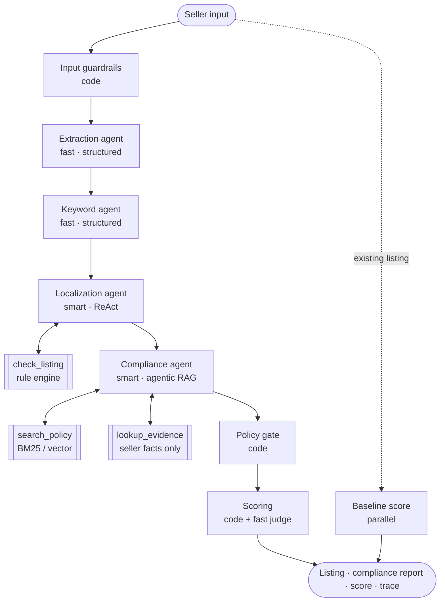

# Agent design

How the AI backend works, stage by stage, and how it maps onto the course concepts (LLM → agent → harness → product).

## 1. The harness (course Module 1)

The model is one component; the harness around it is what makes it a product. Everything in `src/lib/harness`:

| Harness building block   | ListWise implementation                                                                                                                                     |
| ------------------------ | ----------------------------------------------------------------------------------------------------------------------------------------------------------- |
| **Tools**                | `defineTool()` — zod-validated input, per-run call caps, spans per call (`tool-loop.ts`)                                                                    |
| **Memory / context**     | Each agent "wakes up empty": the orchestrator packs exactly the context it needs (facts, keywords, draft, evidence). No shared chat history between agents. |
| **Planning**             | Fixed stage order in the orchestrator; inside the two agentic stages the model plans its own tool calls (ReAct).                                            |
| **Execution**            | `callModel()` (budget check → call → charge → trace), `structuredCall()`, `runToolLoop()`                                                                   |
| **Rules / instructions** | System prompts in `agents/*/prompt.ts`, output contracts in `contracts/`, guardrails in code                                                                |

The agentic loop trusts only `stop_reason`: `tool_use` → execute tools and continue; a final "submit" tool call → validate and return; anything else → one nudge, then fail with `max_iterations`. A turn-budget note forces a best-effort answer on the last turn ("return a partial answer with clear boundaries").

## 2. Hub and spoke

The orchestrator is the hub. Specialists never talk to each other (no peer-to-peer), which keeps each one testable with a fixed input and output contract. Only two stages are agentic, because only they benefit from choosing their own next step; counting, validation, credits and the final gate are plain code.

## 3. Agent cards

### Extraction — `agents/extraction` (WS1)

- **Job:** Chinese text → `ProductFacts` (facts with verbatim source quotes, marketing claims kept separate, missing info).
- **Tier / effort:** fast / low. **Pattern:** single structured call (`output_config.format` from zod).
- **Guardrails:** seller text wrapped in `<seller_input>`; _grounding check_ in code downgrades any fact whose quote is not in the input.
- **Failure modes:** invents specs (caught by grounding check); treats claims as facts (golden `must_flag` cases).

### Keywords — `agents/keywords` (WS1)

- **Job:** facts → `KeywordSet` (3–5 primary, 5–15 secondary). Always labeled **AI-suggested**: we have no search-volume data.
- **Tier / effort:** fast / low. **Post-processing in code:** lowercase, dedupe, drop promotional words.

### Localization — `agents/localization` (WS1)

- **Job:** facts + keywords → `ListingDraft` that passes the platform rule engine.
- **Tier / effort:** smart / medium. **Pattern:** ReAct loop, ≤ 6 turns.
- **Tools:** `check_listing` (≤ 4 calls) runs `validateListing()` + the claim lexicon and returns violations; final tool `submit_listing` (strict schema).
- **Rule:** rewrite, never truncate. The prompt's platform section is generated from the same config the validator uses, so they cannot drift.

### Compliance — `agents/compliance` (WS2)

- **Job:** every seller claim and every claim-like phrase in the draft → `ClaimAssessment` (verified / unverified / restricted, risk, action, suggested fix, evidence ids, policy citations).
- **Tier / effort:** smart / medium. **Pattern:** agentic RAG, ≤ 6 turns.
- **Tools:** `search_policy` (≤ 4 calls — the course's classroom budget), `lookup_evidence` (≤ 8; authorization in code: it can only read _this_ seller's facts and evidence).
- **Stopping rules (in the prompt):** all claims assessed → submit; searches stop adding evidence → state the gap; tool failure / conflict → note in `uncertainty`.
- **Post-processing in code:** _citation integrity_ (drop any policy reference that was not actually retrieved in this run) and _lexicon backstop_ (add any risky draft phrase the agent missed).

### Policy gate — `guardrails/gate.ts` (WS2, code)

Applies rewrite/remove actions, then sweeps every field with the lexicon until nothing restricted remains, re-validates platform rules, and returns PASS/FAIL plus a needs-review list (e.g. unverified claims the seller must confirm).

### Quality judge — `agents/judge` (WS2)

- **Job:** language naturalness and clarity, 1–5 each, with an anchored rubric — the one score dimension code cannot measure. Fast tier, low effort. Also scores the seller's existing listing for the before/after comparison (runs in parallel).

### Scoring — `scoring/score.ts` (WS2, code)

| Dimension            | Weight | How                                                                                              |
| -------------------- | ------ | ------------------------------------------------------------------------------------------------ |
| Keyword relevance    | 25     | Primary keywords in title (50%) and body (30%), secondary coverage (20%)                         |
| Information coverage | 25     | Share of medium/high-confidence facts present; −5 per missing buyer-critical attribute (max −20) |
| Language naturalness | 20     | Judge: 70% naturalness + 30% clarity                                                             |
| Claim verification   | 20     | 100 − 35 per restricted − 10 per unverified claim left − 5 per claim awaiting seller evidence    |
| Format compliance    | 10     | 100 − 25 per rule error − 5 per warning                                                          |

The score is a quality signal, not a conversion prediction; the UI says so.

## 4. Embedded rubrics (course Module 2)

Every agent prompt ends with a self-check over the four dimensions — **scope** (only what was asked), **citation** (facts quote sources / claims cite retrieved policy), **uncertainty** (gaps stated, "couldn't verify X" is a valid answer), **format** (contract followed). The external check is the eval suite (`docs/EVALS.md`).

## 5. Skills → server translation (course Module 4)

| In Claude Code (dev harness)                                  | On the server (product)                                  |
| ------------------------------------------------------------- | -------------------------------------------------------- |
| `.claude/skills/listing-localizer/SKILL.md` step instructions | `src/lib/agents/*/prompt.ts` system prompts              |
| Tools the skill uses by hand                                  | `tools` arrays built by `runToolLoop()` from zod schemas |
| Skill calls skill                                             | `src/lib/pipeline/orchestrator.ts`                       |
| Output format in the skill                                    | zod contracts → structured outputs / strict tools        |

Iterate on a prompt with the skill (it reads the same prompt files), then confirm with `pnpm eval`.

## 6. Models and cost

Two tiers, set by env (`ANTHROPIC_MODEL_SMART`, `ANTHROPIC_MODEL_FAST`) — see `docs/SETUP.md` for current recommended IDs. Prices for the trace's cost column come from env as well. System prompts are sent with `cache_control` so repeated runs hit the prompt cache (watch `cache_read_tokens` in traces).

Per-run budget (`harness/budget.ts`): 24 calls · 250k tokens · $0.75 · 240 s. Typical mock run: 7 calls. Measure live cost per run in traces before changing the Pro cap.

## 7. Adding a platform (e.g. TikTok Shop US — stretch)

1. Verify and fill `src/lib/rules/tiktok-us.ts` (WS2).
2. Add platform guidance to the localization prompt (generated from rules) and any platform-specific policy docs (WS2).
3. Enable the option in the form (WS3) and add golden cases with `"platform": "tiktok_us"` (WS1/WS2).
   No new agent is needed — that is the point of the design.
