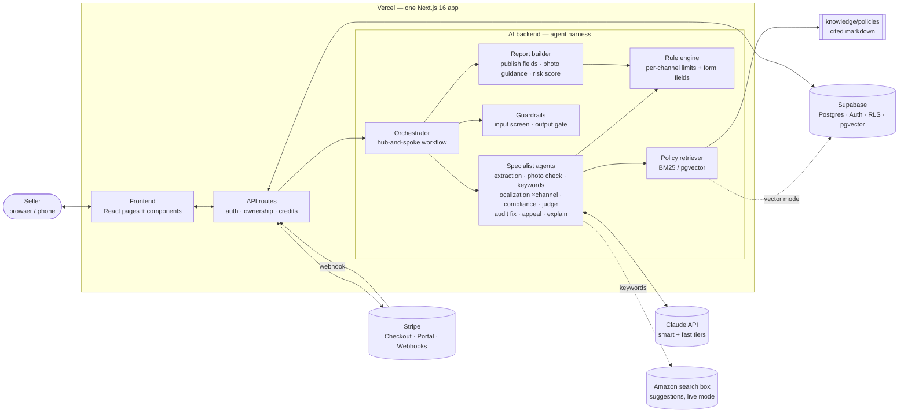
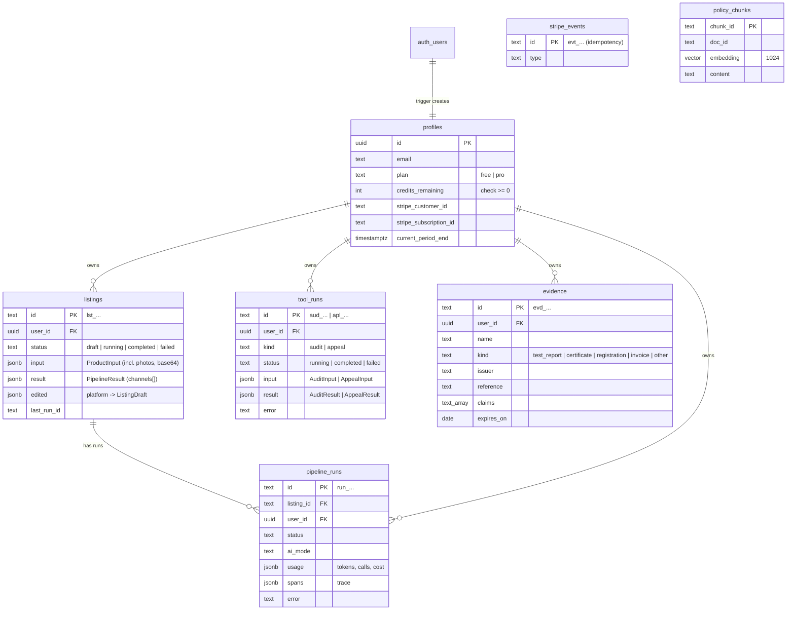

# Architecture

ShelfPass follows the four-layer model from the course (Module 4): **Next.js frontend → API routes → Claude AI backend → Supabase**, deployed together on Vercel, with Stripe for payments. The agent harness is wired straight into that stack rather than replacing it.

## 1. System overview



| Layer      | Tech                                                                                                                                           | Responsibility                                                                                                                                                                              | Owner                     |
| ---------- | ---------------------------------------------------------------------------------------------------------------------------------------------- | ------------------------------------------------------------------------------------------------------------------------------------------------------------------------------------------- | ------------------------- |
| Frontend   | Next.js 16 App Router, React 19, Tailwind v4, design system from `design-system/shelfpass/MASTER.md` (D-017), EN/简体中文 dictionaries (D-018) | Landing, pricing, legal pages, forms, photo resize + white-border measurement, streaming progress, report tabs, marketplace previews, editor, printable report, audit/appeal/evidence pages | WS3                       |
| Backend    | Next.js route handlers (`src/app/api`), `src/proxy.ts`                                                                                         | Auth (email/phone codes, password reset), ownership checks, credits, rate limits, streaming, exports, account export/delete                                                                 | Lead + WS4                |
| AI backend | `src/lib/harness`, `pipeline`, `agents`, `guardrails`, `rules`, `rag`, `scoring`, `report`, `evidence`                                         | The product's core value: the report pipeline, plus audit and appeal pipelines on the same harness                                                                                          | WS1 + WS2 (harness: lead) |
| Data       | Supabase Postgres + Auth + RLS + pgvector                                                                                                      | Users, plans, listings, runs/traces, audits and appeals (`tool_runs`), evidence library, Stripe events, policy vectors                                                                      | WS4                       |
| Payments   | Stripe Checkout + webhooks (test mode)                                                                                                         | Pro subscription and one-time credit packs (D-019)                                                                                                                                          | WS4                       |

## 2. One pipeline run

```mermaid
sequenceDiagram
  autonumber
  participant B as Browser
  participant R as POST /api/listings/:id/run
  participant DB as Repo (Supabase)
  participant O as Orchestrator
  participant C as Claude API

  B->>R: start run
  R->>R: session user · ownership · input screen · rate limit
  R->>DB: consume_credit() (atomic)
  R-->>B: SSE stream opens
  R->>O: runPipeline(input)
  O->>O: Layer 1 guardrails (injection, prohibited, PII redaction, photo file check)
  O->>C: extraction (fast, structured output)
  par photos uploaded
    O->>C: photo check (fast, vision, structured output)
  and
    O->>C: keywords (fast, structured output)
  end
  par one agent per selected channel
    loop ReAct (≤ 6 turns)
      O->>C: localization (smart) → tool_use check_listing
      O->>O: that channel's rule engine validates the draft
    end
  end
  loop Agentic RAG (≤ 4 searches), one review over all drafts
    O->>C: compliance (smart) → search_policy / lookup_evidence
    O->>O: BM25 retrieval (filtered to the selected channels) · evidence lookup
  end
  O->>O: Layer 3 policy gate per channel (apply fixes, strip restricted, re-validate)
  O->>C: quality judge per channel (fast) → score
  O->>O: publish fields + photo guidance per channel · main-image verdicts
  O-->>B: stage events (started / tool_called / completed)
  R->>DB: save run (result + spans + usage)
  alt our failure
    R->>DB: refund_credit()
  end
  R-->>B: run_completed
```



### Audits and appeals

`POST /api/audit` and `POST /api/appeal` follow the same pattern as a report run (`pipeline/tool-route.ts`): session user → zod → deterministic input screen (a blocked input is never charged) → rate limit (5/min) → atomic credit → `repo.createToolRun` → SSE progress (`tool_started`, stage events, `tool_completed` / `tool_failed`) → save the result → refund on our own failure. Both reuse the harness (tracer, budget, mocks), the extraction and compliance agents, the gate and the scorer; only the audit-fix and appeal agents are new. `POST /api/listings/:id/explain` is a single fast-tier call, free and rate limited (10/min). Details: `docs/AGENT_DESIGN.md` §9.

## 3. Module map

```
src/
├─ app/                      Next.js routes (pages + api)
│  ├─ (marketing)/           landing, pricing, terms, privacy, refunds  WS3
│  ├─ (auth)/                login (sign in · create account with      WS4
│  │                         email code · phone code), forgot/reset
│  │                         password
│  ├─ auth/                  callback (PKCE code), confirm (token hash) WS4
│  ├─ (app)/                 dashboard, listings (new, workspace,       WS3
│  │                         report, trace), audit, appeal, evidence,
│  │                         account, billing
│  └─ api/
│     ├─ listings/…          create · get · edit (per channel) ·        lead
│     │                      run (SSE) · export · explain
│     ├─ audit, appeal/…     create (SSE, 1 credit) · get              lead
│     ├─ evidence/…          list · create · delete                    lead
│     ├─ runs/[id]           trace                                      lead
│     ├─ account/…           export (JSON) · delete                     WS4
│     ├─ billing/…           checkout (pro | pack) · portal · mock      WS4
│     ├─ stripe/webhook      verified, idempotent                       WS4
│     └─ auth/…              demo login, logout                         WS4
├─ components/               ui kit · layout (header, footer, language WS3 (auth, billing: WS4)
│                            switch) · listing · tools (audit, appeal,
│                            explain, risk) · preview (Amazon, TikTok
│                            Shop, Shopify) · marketing · evidence ·
│                            auth · billing
├─ lib/
│  ├─ contracts/             zod types + ports; suite.ts = evidence,    lead
│  │                         audit, appeal, risk, explanation
│  ├─ harness/               LLM client, structuredCall, runToolLoop,   lead
│  │                         tracer, budget, errors, pricing
│  ├─ pipeline/              orchestrator · audit · appeal ·            WS1 (+ lead)
│  │                         tool-run / tool-route (SSE + credits)
│  ├─ agents/                extraction · keywords (+ Amazon search-    WS1
│  │                         box suggestions) · localization
│  │                         compliance · judge · images                WS2
│  │                         audit (parse, fix, repair) · appeal ·      lead
│  │                         explain
│  ├─ guardrails/            input screen · PII · photo check ·         WS2
│  │                         claim lexicon · gate
│  ├─ rules/                 amazon-us · tiktok-us · shopify configs    WS2
│  │                         (limits + form fields), registry, validate
│  ├─ report/                fields · images (main-image verdicts,      WS1
│  │                         measured white border) · risk · view
│  │                         (edits re-checked) · markdown
│  ├─ evidence/              library → evidence text (expired left out) lead
│  ├─ rag/                   corpus loader · BM25 · vector retriever    WS2
│  ├─ scoring/               quality score                              WS2
│  ├─ i18n/                  config, en + zh dictionaries by area,      WS3
│  │                         getT() / useT()
│  ├─ db/ auth/ billing/     ports' implementations; billing/credits.ts WS4
│  │                         holds the credit rules
│  ├─ platform/              rate limiting                              WS4
│  └─ export/                MD / JSON (all channels), CSV / TXT        WS3
│                            (one channel's form fields)
└─ proxy.ts                  Supabase session refresh                   WS4
knowledge/policies/          compliance knowledge base                  WS2
evals/                       golden, audit, appeal, retrieval datasets, WS2 (+WS1 datasets)
                             runner
supabase/migrations/         schema, RLS, credit functions, pgvector,   WS4
                             evidence + tool_runs (20261020…)
design-system/shelfpass/     design system (ui-ux-pro-max skill)        WS3
```

## 4. Ports and adapters

Routes and agents depend on interfaces in `src/lib/contracts/ports.ts`, never on vendors directly. Each port has a zero-setup implementation so everyone can work from day one, and the production one is selected by env:

| Port              | Zero-setup implementation                 | Production implementation       | Switch         |
| ----------------- | ----------------------------------------- | ------------------------------- | -------------- |
| `LlmClient`       | `MockLlmClient` (scripted, deterministic) | `LiveLlmClient` (Anthropic SDK) | `AI_MODE`      |
| `Repo`            | `MemoryRepo` (also the executable spec)   | `SupabaseRepo`                  | `DATA_MODE`    |
| `BillingProvider` | `MockBilling`                             | `StripeBilling`                 | `BILLING_MODE` |
| `PolicyRetriever` | `LexicalRetriever` (BM25)                 | `VectorRetriever` (pgvector)    | `RAG_MODE`     |
| Session           | demo cookie                               | Supabase Auth                   | `DATA_MODE`    |

## 5. Data model



Security model: RLS on every table (users see only their rows); plan/credit changes and Stripe events only through the server's secret key; `consume_credit` / `refund_credit` / `add_credits` are `SECURITY DEFINER` functions granted to `service_role` only. Deleting a profile cascades to listings, runs, tool runs and evidence; the account delete route cancels an active Stripe subscription first and then deletes the auth user.

`SupabaseRepo` runs every query on the server with the secret key (D-013): the browser never queries tables, and the pipeline keeps writing after the request's cookies are gone (SSE stream). Because that key bypasses RLS, **every read and write of user data filters by `user_id` in code**; RLS stays on as the second wall. `listings.input` holds the seller's photos (base64), so the dashboard query selects JSON paths (`input->>title_zh`, `result->channels`) instead of whole rows.

### Result shape

`PipelineResult` = `{ platforms, facts, keywords, channels[], compliance, images, baseline_score, warnings }`. Each `ChannelResult` = `{ platform, draft, listing, validation, gate, score, fields[], images }`, where `fields` are the site's "add product" form fields in order (`source`: generated / fact / seller; `status`: ok / warning / missing) and `images` is the main-image rules, gallery guidance and shot list. Seller edits are stored per channel in `listings.edited`; `channelViews()` re-validates and re-screens them in code before anything is shown or exported, and computes each channel's takedown-risk score (`report/risk.ts`). Because the risk score is computed on read, it also works on reports saved before it existed.

## 6. Deployment

- **Vercel**: one project, deployed with the Vercel CLI from `main` (D-015; the Git integration is not connected, so merges need `vercel deploy --prod`). Env vars per environment (see `docs/DEPLOYMENT.md`).
- **Supabase**: one project; migrations in `supabase/migrations` applied via SQL editor or `supabase db push` (`20261018…_init.sql`, then `20261020…_compliance_suite.sql`). Auth dashboard settings (SMTP, confirm email, templates, SMS provider): `docs/AUTH_SETUP.md`.
- **Stripe**: test mode; webhook endpoint `https://<domain>/api/stripe/webhook` subscribed to `checkout.session.completed` (Pro and credit packs), `invoice.paid`, `customer.subscription.deleted`. Credit packs use inline `price_data`, so no extra product is needed. A handler that throws releases its event id so Stripe's retry is applied.
- **Limits that shaped the design**: Vercel request bodies ≤ 4.5 MB (photos are resized in the browser to ≤ 1024 px JPEG, ≤ ~650 KB each, 4 max); the run route has `maxDuration = 300` (localization runs in parallel per channel to stay well under it).
- **CI** (GitHub Actions): ownership check → lint → typecheck → unit tests → evals (mock) → build → Playwright smoke test.

## 7. Key trade-offs

See `memory/decisions.md` for the full log. The big ones: a fixed workflow with two agentic loops instead of a free-roaming agent (D-003); contracts-first with mock mode everywhere (D-004); structured outputs instead of forced tool choice (D-005); streaming instead of background jobs (D-006); lexical RAG first, vector as a measured upgrade (D-008); defense in depth for claims (D-009); a field-by-field report instead of live publishing APIs, one localization agent per channel and one shared compliance review (D-011, D-012); server-side secret-key data access with explicit `user_id` filters (D-013); the Listing Copilot features ported onto the same harness instead of a second app (D-016); a generated design system, light mode only (D-017); typed bilingual dictionaries (D-018); credit packs with inline Stripe prices and verification through Supabase Auth (D-019).
