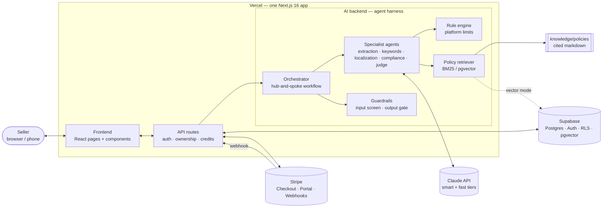
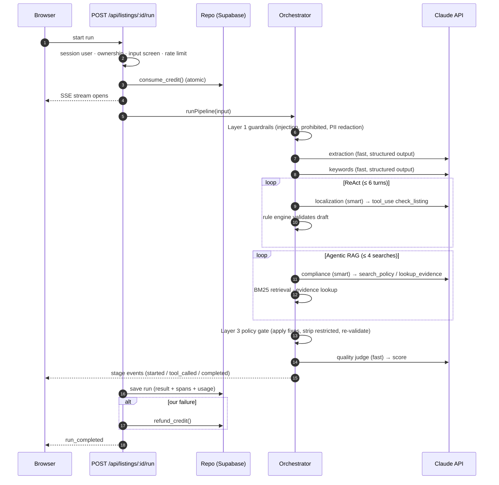
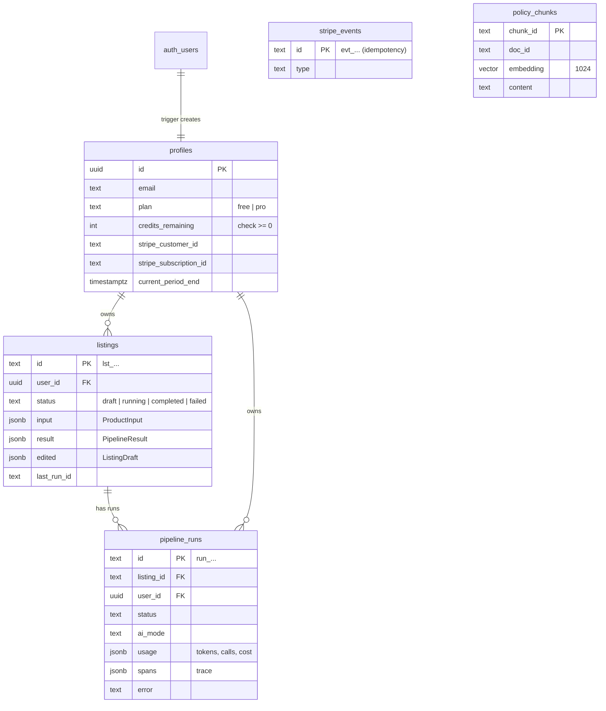

# Architecture

ListWise follows the four-layer model from the course (Module 4): **Next.js frontend → API routes → Claude AI backend → Supabase**, deployed together on Vercel, with Stripe for payments. The agent harness is wired straight into that stack rather than replacing it.

## 1. System overview



| Layer      | Tech                                                                             | Responsibility                                                     | Owner                     |
| ---------- | -------------------------------------------------------------------------------- | ------------------------------------------------------------------ | ------------------------- |
| Frontend   | Next.js 16 App Router, React 19, Tailwind v4                                     | Pages, forms, streaming progress, editor, export                   | WS3                       |
| Backend    | Next.js route handlers (`src/app/api`), `src/proxy.ts`                           | Auth, ownership checks, credits, rate limits, streaming            | Lead + WS4                |
| AI backend | `src/lib/harness`, `pipeline`, `agents`, `guardrails`, `rules`, `rag`, `scoring` | The product's core value                                           | WS1 + WS2 (harness: lead) |
| Data       | Supabase Postgres + Auth + RLS + pgvector                                        | Users, plans, listings, runs/traces, Stripe events, policy vectors | WS4                       |
| Payments   | Stripe Checkout + webhooks (test mode)                                           | Pro subscription                                                   | WS4                       |

## 2. One pipeline run



## 3. Module map

```
src/
├─ app/                      Next.js routes (pages + api)
│  ├─ (marketing)/           landing                                   WS3
│  ├─ (auth)/login, auth/    sign-in, email callback                    WS4
│  ├─ (app)/                 dashboard, listings, trace, billing        WS3
│  └─ api/
│     ├─ listings/…          create · get · edit · run (SSE) · export   lead
│     ├─ runs/[id]           trace                                      lead
│     ├─ billing/…           checkout · portal · mock                   WS4
│     ├─ stripe/webhook      verified, idempotent                       WS4
│     └─ auth/…              demo login, logout                         WS4
├─ components/               UI kit + listing/billing/auth components  WS3 (auth: WS4)
├─ lib/
│  ├─ contracts/             zod types + ports (interfaces)             lead
│  ├─ harness/               LLM client, structuredCall, runToolLoop,   lead
│  │                         tracer, budget, errors, pricing
│  ├─ pipeline/              orchestrator                               WS1
│  ├─ agents/                extraction · keywords · localization       WS1
│  │                         compliance · judge                         WS2
│  ├─ guardrails/            input screen · PII · claim lexicon · gate  WS2
│  ├─ rules/                 platform rule configs + validator          WS2
│  ├─ rag/                   corpus loader · BM25 · vector retriever    WS2
│  ├─ scoring/               quality score                              WS2
│  ├─ db/ auth/ billing/     ports' implementations                     WS4
│  ├─ platform/              rate limiting                              WS4
│  └─ export/                CSV / TXT / JSON                           WS3
└─ proxy.ts                  Supabase session refresh                   WS4
knowledge/policies/          compliance knowledge base                  WS2
evals/                       golden + retrieval datasets, runner        WS2 (+WS1 datasets)
supabase/migrations/         schema, RLS, credit functions, pgvector    WS4
```

## 4. Ports and adapters

Routes and agents depend on interfaces in `src/lib/contracts/ports.ts`, never on vendors directly. Each port has a zero-setup implementation so everyone can work from day one, and the production one is selected by env:

| Port              | Zero-setup implementation                 | Production implementation       | Switch         |
| ----------------- | ----------------------------------------- | ------------------------------- | -------------- |
| `LlmClient`       | `MockLlmClient` (scripted, deterministic) | `LiveLlmClient` (Anthropic SDK) | `AI_MODE`      |
| `Repo`            | `MemoryRepo`                              | `SupabaseRepo`                  | `DATA_MODE`    |
| `BillingProvider` | `MockBilling`                             | `StripeBilling`                 | `BILLING_MODE` |
| `PolicyRetriever` | `LexicalRetriever` (BM25)                 | `VectorRetriever` (pgvector)    | `RAG_MODE`     |
| Session           | demo cookie                               | Supabase Auth                   | `DATA_MODE`    |

## 5. Data model



Security model: RLS on every table (users see only their rows); plan/credit changes and Stripe events only through the server's secret key; `consume_credit` / `refund_credit` are `SECURITY DEFINER` functions granted to `service_role` only. Application code still filters by `user_id` on every query (defense in depth).

## 6. Deployment

- **Vercel**: one project linked to GitHub; every push to `main` deploys production, every PR gets a preview URL. Env vars per environment (see `docs/DEPLOYMENT.md`).
- **Supabase**: one project; migrations in `supabase/migrations` applied via SQL editor or `supabase db push`.
- **Stripe**: test mode; webhook endpoint `https://<domain>/api/stripe/webhook` subscribed to `checkout.session.completed`, `invoice.paid`, `customer.subscription.deleted`.
- **CI** (GitHub Actions): ownership check → lint → typecheck → unit tests → evals (mock) → build → Playwright smoke test.

## 7. Key trade-offs

See `memory/decisions.md` for the full log. The big ones: a fixed workflow with two agentic loops instead of a free-roaming agent (D-003); contracts-first with mock mode everywhere (D-004); structured outputs instead of forced tool choice (D-005); streaming instead of background jobs (D-006); lexical RAG first, vector as a measured upgrade (D-008); defense in depth for claims (D-009).
