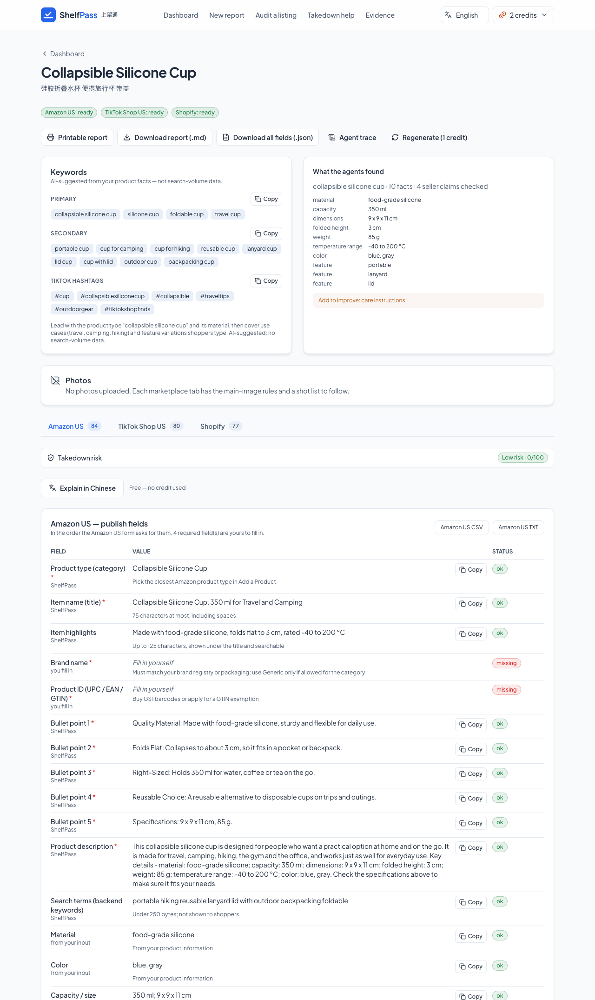
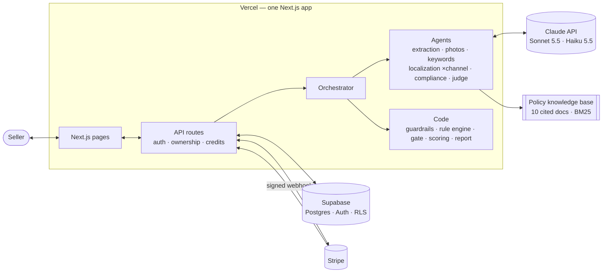

# ShelfPass — capstone write-up

**Turn Chinese product information into one compliance-checked, publish-ready report for Amazon US, TikTok Shop US and Shopify.**

**Team:** Team 9 · **Live URL:** https://shelfpass.vercel.app · **Repo:** https://github.com/heruis/ecommerce-agent
UCLA _440 Building LLM Applications_ capstone. All numbers below come from live runs on 2026-10-19 with `claude-sonnet-5-5` (smart tier) and `claude-haiku-5-5` (fast tier), unless marked "mock".

---

## 1. Problem and users

Chinese small and mid-size sellers list thousands of products on US channels: Amazon, TikTok Shop and their own Shopify stores. Their source material is Chinese supplier copy written for a domestic audience, full of claims that are normal in China and risky in the US: "FDA认证" (FDA certified), "100%安全" (100% safe), "美国销量第一" (#1 in the US), "抗菌" (antibacterial), "环保可降解" (eco-friendly, degradable). Each channel also wants different fields (Amazon: a 200-character title, five bullets, 249 bytes of hidden search terms; TikTok Shop: a short title and hashtags; Shopify: an SEO title and meta description) and its own photo rules.

**Target user.** An owner-operator of a 1–10 person seller in Shenzhen or Yiwu with 50–500 SKUs on two or three channels, who reads English but writes it slowly. Job to be done: _"Get listings I can publish today on every channel without getting flagged."_ Today they paste the text into ChatGPT or pay a freelancer per listing per channel. The cost is listing suppression, account warnings, returns from misleading copy, and hours of rework per product per channel.

**Why AI.** The job needs language understanding (facts out of messy Chinese copy), generation (natural US copy in each channel's style), vision (is this photo usable as a main image?) and judgment (is this claim supported by the seller's evidence?). Rules alone cannot write a listing; an LLM alone cannot be trusted with compliance. ShelfPass combines both: models write and reason, code enforces.

**Why not just ChatGPT.** ChatGPT faithfully translates "FDA认证" into "FDA Approved", which is a misleading claim on a US listing. It has no per-channel rule engine, no cited policy knowledge base, no field-by-field mapping onto each site's form, no measurable score and no workflow to edit, re-check and export. That gap is the product.

**Evidence of demand.** _TODO: 2–3 seller interviews: who (role, channels, SKUs), their current process and its cost, the quote that best states the pain, reaction to the demo, willingness to pay $9.99/month._

## 2. Solution and demo flow

1. **Sign up** (Supabase Auth) and land on the dashboard with 3 free runs.
2. **New listing:** paste the Chinese name, description and specs; optionally evidence (test reports), brand, the current English listing and up to 4 photos (resized in the browser); tick the channels.
3. **Generate report:** the agent pipeline streams live: guardrails → extraction → photo check and keywords → one localization agent per channel in parallel → one compliance review → policy gate → score. A three-channel live run takes about 40 seconds.
4. **Review:** AI-suggested keywords, extracted facts, photo verdicts, and one tab per channel with every field of that site's "add product" form in order, each with a copy button and marked _generated_, _from your input_ or _you fill in_ (UPC, price). The shared claim review shows, for example, "FDA approved" → restricted → "made with food-grade silicone", citing the FDA source.
5. **Edit and re-check:** saving any field re-runs that channel's rules and the claim screen in code; adding "FDA approved" back flips the gate to FAIL.
6. **Export and pay:** printable report (print to PDF), Markdown, JSON, or one channel's fields as CSV/TXT. Out of runs → Stripe Checkout (test mode) → Pro.

**Report, not live publishing.** Posting directly through Amazon SP-API, the TikTok Shop Partner API or the Shopify Admin API needs developer registration and app review that take weeks; the capstone had one week. The report gives the seller every field to paste, with nothing stored about their marketplace accounts (D-011).

**Pricing and unit economics.** Free: 3 runs. Pro: $9.99/month for 50 runs (one run = one product, up to three channels). Measured model cost is $0.08–0.11 per three-channel run, so a Pro user who uses all 50 runs costs about $4–5.50 in model calls: a positive margin even in the worst case. The cap (instead of "unlimited") keeps API cost bounded (D-010).

## 3. Architecture

One Next.js 16 app on Vercel holds the frontend, the API routes and the AI backend; Supabase holds users, listings, run traces and credits; Stripe handles the subscription.

**Ports and adapters.** Every external dependency sits behind an interface with a zero-setup implementation and a production one, chosen by one env switch each: `AI_MODE` (scripted mock ↔ Claude), `DATA_MODE` (in-memory ↔ Supabase), `BILLING_MODE` (mock ↔ Stripe), `RAG_MODE` (BM25 ↔ pgvector). So the app, tests and CI run offline for free, each workstream replaced its own stub without waiting for the others, and lead-owned zod contracts (`src/lib/contracts`) keep parallel branches from breaking each other.

**Data and security.** Tables: profiles (plan, credits), listings, pipeline runs (result, spans, usage) and Stripe events, all with row-level security. The server uses Supabase's secret key, so every query also filters by the session user's id in code (D-013); ids in URLs are never trusted alone. Credits change only through atomic SQL functions (`consume_credit`, `refund_credit`): a blocked input costs nothing, and a run that fails for a system reason is refunded. The Stripe webhook verifies the signature, records each event id first so a replay changes nothing, and releases the record if a handler fails so Stripe's retry is applied.

**Deployment.** Live at https://shelfpass.vercel.app, verified end to end: sign-up creates a profile with 3 runs; a live report used one credit (41 s, $0.11, 14 model calls); a test-card checkout set the account to Pro with 50 runs through the webhook, and cancelling in the customer portal set it back to Free. Secrets live only in Vercel (private keys stored as _Sensitive_) and in each developer's `.env.local`. Photos are resized in the browser to stay under Vercel's 4.5 MB request limit, and the run route allows 300 s.

## 4. AI design

**A workflow with two agentic stages, not a free-roaming agent.** A fixed orchestrator (hub) gives each specialist (spoke) exactly the context it needs; specialists never talk to each other, so each can be tested alone against a fixed contract (D-003). Only the two stages that benefit from choosing their own next step are agents; counting, validation, credits, the final gate and the field mapping are plain code.

| Stage                 | Tier              | Pattern                                                     | Why                                                                                     |
| --------------------- | ----------------- | ----------------------------------------------------------- | --------------------------------------------------------------------------------------- |
| Extraction            | fast              | One structured call                                         | Chinese text → facts with verbatim source quotes, claims kept separate                  |
| Photo check           | fast              | One structured call with images                             | The model describes each photo; code decides each channel's main-image verdict          |
| Keywords              | fast              | One structured call                                         | One AI-suggested set for all channels (no search-volume data, and the UI says so)       |
| Localization ×channel | smart             | ReAct loop (≤ 6 turns), one per channel, in parallel        | Drafts, calls `check_listing` (that channel's rule engine), rewrites until it passes    |
| Compliance            | smart             | Agentic RAG (≤ 4 policy searches), one review of all drafts | A claim is the same claim on every channel, so it is judged once and applied everywhere |
| Gate, scoring, fields | code + fast judge | Deterministic, per channel                                  | Restricted phrases are stripped in code; the judge rates only naturalness and clarity   |

**Contracts and the loop.** Every model output is schema-enforced (structured outputs for single calls, a strict "submit" tool for loops) and re-validated with zod, with one repair attempt. The tool loop trusts only `stop_reason`. Each channel's prompt section is generated from the same rule config the validator and the form-field map use (`src/lib/rules/<channel>.ts`), so the prompt, the check and the output cannot drift; adding a channel is a config file, not a new agent (D-012). The submission itself is validated in code: a listing that still breaks the channel's rules goes back to the agent once with the errors, then the gate reports what is left.

**Models and cost.** Model ids come only from env. Sonnet 5.5 writes and reviews; Haiku 5.5 extracts, describes photos, suggests keywords and judges (D-015). Each run has hard budgets in code: 40 model calls, 400k tokens, $1.50 and 240 s. Measured on the 13 golden cases after the fixes: 13–15 model calls per three-channel case, $0.083–0.086 and 31–34 s on average, well under the PRD targets of $0.15 and 90 s. System prompts are cached; the live demo run read about 10k of its input tokens from the cache.

**Errors and edge cases.** Blocked input (prompt injection in English or Chinese, prohibited products such as vapes, fake image files) stops before any model call and costs no credit; contact details are redacted before the model sees them. A schema failure gets one repair; an agent that never finishes fails with `max_iterations`; a budget breach stops the run; any system failure refunds the credit; a failed photo check is skipped with a warning instead of failing the run. Every stage, model call and tool call is traced with tokens and cost on a trace page.

## 5. Trust: compliance, guardrails and evals

**Agentic RAG with citations.** The compliance agent chooses its own queries over a knowledge base of 10 paraphrased, cited policy documents (FDA approval, EPA pesticide claims, FTC Green Guides, Made in USA, substantiation, comparative claims, Amazon content rules), chunked per section with source URLs and filtered to the selected channels. Its second tool, `lookup_evidence`, can only read this seller's facts and evidence (authorization in code). Code then enforces citation integrity: a citation that was not retrieved in this run is dropped, and every restricted claim left without one is cited from its rule's policy document through the same retriever.

**Three guardrail layers.** (1) _Input:_ injection and prohibited-product screens, PII redaction, photo signature checks, and all seller text wrapped in `<seller_input>` tags that every prompt treats as data. (2) _Actions:_ least-privilege tools (no agent can write data, publish or touch money), per-tool call caps and run budgets in code. (3) _Output:_ a deterministic claims lexicon (English and Chinese) backstops the agent, and the per-channel policy gate applies fixes wherever a phrase appears (including SEO fields and tags), sweeps until nothing restricted remains, and re-validates. Seller edits pass through the same checks. This defense in depth means a restricted phrase cannot reach a final listing even if the model misses it (D-009).

**Evals.** 13 golden cases with ground truth written before running: risky claims, seller evidence that supports a claim, a clean product, prompt injection, a prohibited product, contact details and a single-channel case. Each case is checked on four dimensions for **every** channel: outcome (required facts, minimum score), process (every expected claim type flagged; every restricted claim cited), output contract (no forbidden phrase, gate PASS, channel rules pass, no empty required field) and efficiency (model-call cap). The ship rule is ≥ 80%. Retrieval has its own 15-query set: recall@3 0.93, precision@3 0.90, MRR 1.00, NDCG@3 0.95.

| Golden suite (13 cases × every channel) | Pass rate   | Cost / latency per case |
| --------------------------------------- | ----------- | ----------------------- |
| Mock (CI, every PR)                     | 13/13       | —                       |
| Live baseline                           | 10/13 (77%) | $0.091 / 34 s           |
| Live after fixes, run 1                 | **13/13**   | $0.083 / 31 s           |
| Live after fixes, run 2                 | **13/13**   | $0.086 / 34 s           |

**A failure the evals caught.** The yoga-mat case failed on every live run. The compliance agent had correctly restricted the seller's 可降解, but extraction translated it as "Degradable", and the lexicon only knew "biodegradable". That was a real safety gap, not a test artifact: the output gate would have let "degradable" into a live listing, although the FTC Green Guides cover it. We widened the rule to every degradability claim, with a unit test, and fixed two flaky failures the same way: material abbreviations ("PP") are now spelled out in code, and listings that break channel rules are rejected at submission in code ([#1](https://github.com/heruis/ecommerce-agent/pull/1), [#2](https://github.com/heruis/ecommerce-agent/pull/2)). No golden case was edited.

## 6. Key design decisions

- **Workflow with agentic steps, not one big agent (D-003)** → each stage is testable, traceable and cheap → less autonomy, which this task does not need.
- **Defense in depth for claims: agent + lexicon + gate (D-009)** → a missed "FDA approved" is the worst failure, so code has the last word → the lexicon can over-flag, which the seller resolves in review.
- **A publish-ready report instead of direct publishing (D-011)** → marketplace API approval takes weeks → the seller pastes fields instead of one click; direct publishing is the top roadmap item.
- **Contracts first, mock mode everywhere (D-004)** → the team built in parallel from day one with free, deterministic CI → mock results prove the plumbing only, so live evals are mandatory (see lessons).

## 7. Lessons learned and next steps

**Lessons.**

1. _Mock green is not a quality signal._ Mock evals passed every case from day one; the first live run passed 10/13. Mock agents prove the plumbing, not the prompts.
2. _A rule the model must follow belongs in code._ "Check your listing before you submit" was only in the prompt, and the agent sometimes submitted a title with "phone" three times. Moving the check into code fixed it for good.
3. _One green run can be luck._ Two of three live failures passed on a simple re-run, so we required two consecutive 13/13 runs before calling the fixes done.

**Known limits.** The policy knowledge base is paraphrased and not yet verified against the official sources; keywords are AI-suggested, not search-volume data; the quality judge is not yet calibrated against human ratings; 13 golden cases is a small set; production deploys are manual until Git is connected to Vercel.

**Next steps, in priority order:**

1. **Verify the knowledge base** (FDA, EPA, FTC, Amazon, plus a TikTok Shop claims doc) and grow the golden set to 18+ red-team cases. Measure: live pass rate and zero restricted phrases leaking.
2. **Partial reports:** keep the other channels when one channel's agent fails. Measure: share of runs that complete.
3. **Direct publishing,** Shopify Admin API first (simplest app approval), then Amazon SP-API Listings. Measure: time from input to a live listing.
4. **Bulk CSV import, real keyword data and a Chinese UI** for agency users. Measure: listings per hour per operator, and willingness to pay from the seller interviews.
