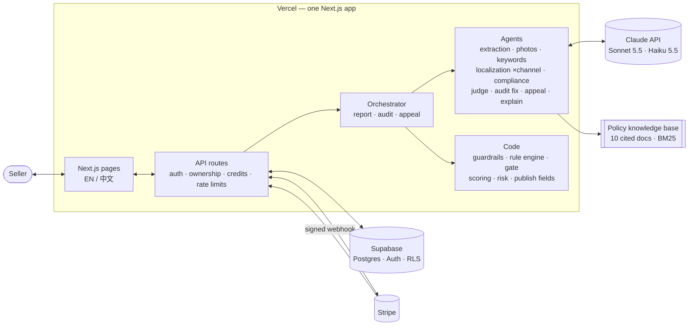

# ShelfPass — capstone write-up

**Turn Chinese product information into one compliance-checked, publish-ready report for Amazon US, TikTok Shop US and Shopify, then keep those listings online.**

**Team 9** · **Live URL:** https://shelfpass.vercel.app · **Repo:** https://github.com/heruis/ecommerce-agent · UCLA _440 Building LLM Applications_

Live numbers come from runs with `claude-sonnet-5-5` (smart tier) and `claude-haiku-5-5` (fast tier) on 2026-10-19; numbers marked "mock" come from the offline mode that CI runs on every change.

---

## 1. Problem and users

Chinese small and mid-size sellers list thousands of products on US channels: Amazon, TikTok Shop and their own Shopify stores. Their source material is Chinese supplier copy written for a domestic audience and full of claims that are normal in China but risky in the US: "FDA认证" (FDA certified), "100%安全" (100% safe), "美国销量第一" (#1 in the US), "抗菌" (antibacterial), "环保可降解" (eco-friendly, degradable). Each channel also wants different fields: Amazon a title of at most 75 characters (since July 27, 2026), a 125-character Item Highlights line, five bullets and 249 bytes of hidden search terms; TikTok Shop a short title and hashtags; Shopify an SEO title and meta description. Each has its own photo rules.

**Target user.** The owner-operator of a 1–10 person seller in Shenzhen or Yiwu with 50–500 SKUs on two or three channels, who reads English but writes it slowly. Job to be done: _"Get listings I can publish today on every channel without getting flagged."_ Today they paste the text into ChatGPT or pay a freelancer per listing per channel. The cost of getting it wrong is listing suppression, account warnings, takedowns written in English they struggle to read, returns from misleading copy, and hours of rework per product per channel.

**Why AI is the right tool.** The job needs language understanding (facts out of messy Chinese copy), generation (natural US copy in each channel's style), vision (is this photo usable as a main image?) and judgment (is this claim supported by the seller's evidence?). Rules alone cannot write a listing, and an LLM alone cannot be trusted with compliance. ShelfPass combines the two: models write and reason, code enforces.

**Why not just ChatGPT.** ChatGPT faithfully translates "FDA认证" into "FDA Approved", a misleading claim on a US listing. It has no per-channel rule engine, no cited policy knowledge base, no mapping onto each site's "add product" form, no measurable quality or risk score, and no workflow to edit, re-check and export. That gap is the product.

## 2. Solution

**The core report.** The seller pastes Chinese product information, ticks the channels and optionally adds up to four photos and the test reports or certificates they hold. A pipeline of specialist agents extracts the facts, suggests one set of US keywords (using real phrases from Amazon's search box when they fit), checks the photos against each site's main-image rules, writes one listing per channel in parallel, verifies every marketing claim once across all channels against the seller's evidence and a cited policy knowledge base, and maps each listing onto that site's form field by field with copy buttons. Each channel gets a 0–100 quality score and a 0–100 takedown-risk score, and a marketplace-style preview shows the copy as an Amazon page, a TikTok Shop phone page or a Google result for a Shopify store.

**The compliance suite** (merged from a teammate's prototype, D-016) keeps listings online after launch: _audit a live listing_ (risky claims with citations, the smallest fix, risk before → after), _takedown and appeal help_ (likely cause, what to change, which documents help, a short appeal letter in English), an _evidence library_ (a claim stays only when a document the seller holds backs it), and a free _explanation in Chinese_ of every change.

**Seller journey (the demo).**

1. Sign up with an email code; the dashboard shows 3 free credits.
2. Add test reports to the evidence library; start a new report from the collapsible-cup example.
3. If the information is too thin ("杯子，质量很好"), ShelfPass stops before writing and asks 1–4 questions in English and Chinese; no credit is used. Otherwise the run streams live: about 30–40 seconds for three channels.
4. Review the per-channel tabs: "FDA认证" became "made with food-grade silicone" with the FDA source cited, "#1 in the US" was removed, and the Amazon title fits 75 characters with the details moved to Item Highlights.
5. Edit any field: saving re-runs that channel's rules and the claim screen in code, so adding "FDA approved" back flips the gate to FAIL.
6. Export (printable report, Markdown, JSON, CSV/TXT per channel), audit a live listing, analyze a takedown notice.
7. Out of credits → Stripe Checkout (test mode) for a credit pack or Pro → account page with data export and deletion.

**A report, not live publishing.** Publishing through Amazon SP-API, the TikTok Shop Partner API or the Shopify Admin API needs developer registration and app review that take weeks; the capstone had one. The report gives every field to paste and stores nothing about the seller's marketplace accounts (D-011).

**Pricing and unit economics.** Free: 3 credits. Credit pack: $4.99 for 20 credits that never expire. Pro: $9.99 per month, balance topped up to at least 50 each month. One credit is one multi-channel report, one audit or one takedown analysis; explanations in Chinese are free. A live three-channel report costs $0.08–0.09 in model calls, so a full Pro month costs at most about $4.50 and a full pack about $1.80 before Stripe fees: a positive margin in the worst case, and the cap instead of "unlimited" keeps API cost bounded (D-010, D-019).

## 3. Architecture

One Next.js 16 app on Vercel holds the frontend, the API routes and the AI backend; Supabase holds users, listings, runs, evidence and credits; Stripe handles subscriptions and packs.

**Ports and adapters.** Every external dependency sits behind an interface with a zero-setup implementation and a production one, chosen by one env switch each: `AI_MODE` (scripted mock ↔ Claude), `DATA_MODE` (in-memory ↔ Supabase), `BILLING_MODE` (mock ↔ Stripe), `RAG_MODE` (BM25 ↔ pgvector). The app, tests and CI run offline for free; each workstream replaced its own stub without waiting for the others; lead-owned zod contracts (`src/lib/contracts`) keep parallel branches from breaking each other.

**Data and security.** Profiles (plan, credits), listings, runs (result, spans, usage), evidence, tool runs (audits, appeals) and Stripe events, all with row-level security. The server uses Supabase's secret key, so every query also filters by the session user's id in code (D-013); an id in a URL is never trusted alone. Credits change only through atomic SQL functions: blocked input costs nothing, and a run that fails for a system reason, or stops to ask the seller for details, is refunded. The Stripe webhook verifies the signature and records each event id first, so a replay changes nothing.

**Deployment and production readiness.** Live at https://shelfpass.vercel.app; `/api/health` reports `ai: live, data: supabase, billing: stripe`. Verified on the live URL: sign-up created a profile with 3 credits; a live report used one credit (41 s, $0.11, 14 model calls); a test-card checkout set the account to Pro through the webhook, and cancelling in the customer portal set it back to Free. Secrets live only in Vercel environment variables (private keys marked _Sensitive_) and in each developer's `.env.local`. Every failure has a state the seller can act on: out of credits → pricing; blocked input → why; system failure → "your credit was refunded"; thin input → questions. Password reset, data export, account deletion and terms, privacy and refund pages are in place.

## 4. AI design

**A fixed workflow with two agentic stages, not a free-roaming agent.** An orchestrator (hub) gives each specialist (spoke) exactly the context it needs; specialists never talk to each other, so each can be tested alone against a fixed contract (D-003). Only the stages that benefit from choosing their own next step are agents; counting, validation, credits, the gate, the risk score and the field mapping are plain code.

| Stage                    | Tier              | Pattern                                              | Why                                                                                       |
| ------------------------ | ----------------- | ---------------------------------------------------- | ----------------------------------------------------------------------------------------- |
| Extraction               | fast              | One structured call + code checks                    | Chinese text → facts with verbatim quotes; claims kept apart; too thin → questions        |
| Photo check              | fast              | One structured call with images                      | The model describes each photo; code decides each channel's main-image verdict            |
| Keywords                 | fast              | One structured call + search-box phrases             | One AI-suggested set for all channels (no search-volume data, and the UI says so)         |
| Localization ×channel    | smart             | ReAct loop (≤ 6 turns), in parallel                  | Drafts, calls `check_listing` (that channel's rule engine), rewrites until it passes      |
| Compliance               | smart             | Agentic RAG (≤ 4 searches), one review of all drafts | A claim is the same claim on every channel: judged once, applied everywhere               |
| Gate, scoring, risk      | code + fast judge | Deterministic, per channel                           | Restricted phrases stripped and numbers checked in code; the judge rates only naturalness |
| Audit · appeal · explain | smart / fast      | Minimal-fix agent; agentic RAG; one call             | Audits keep untouched fields byte-identical; appeals cite only retrieved policies         |

**Contracts and the loop.** Every model output is schema-enforced (structured outputs for single calls, a strict "submit" tool for loops) and re-validated with zod, with one repair attempt. The tool loop trusts only `stop_reason`. Each channel's prompt section is generated from the same rule config the validator and the form map use (`src/lib/rules/<channel>.ts`), so prompt, check and output cannot drift: moving Amazon to 75-character titles and adding Item Highlights was a config change plus one new field (D-020). A submission that still breaks the channel's rules goes back to the agent once with the errors; then the gate reports what is left.

**Errors and edge cases.** Prompt injection (English or Chinese), prohibited products and fake image files stop before any model call and cost no credit; contact details are redacted before the model sees them. Input too thin to write from stops after extraction with questions instead of a padded listing: code requires a product type plus at least one stated material, size or concrete feature, and the model only phrases the questions (D-021). Any number in a final listing that is neither in the seller's text nor a unit conversion of it is flagged as a possibly invented spec (D-022). A schema failure gets one repair; an agent that never finishes fails with `max_iterations`; a budget breach stops the run; any system failure refunds the credit; a failed photo check is skipped with a warning. Every stage, model call and tool call is traced with tokens and cost on a trace page.

**Models and cost.** Model ids come only from env: Sonnet 5.5 writes and reviews; Haiku 5.5 extracts, describes photos, suggests keywords, judges and explains (D-015). Each run has hard budgets in code: 40 model calls, 400k tokens, $1.50 and 240 s. Measured live: 13–15 model calls, $0.083–0.086 and 31–34 s per three-channel case, under the PRD targets of $0.15 and 90 s.

## 5. Trust and evaluation

**Agentic RAG with citations.** The compliance agent chooses its own queries over 10 paraphrased, cited policy documents (FDA approval, EPA pesticide claims, FTC Green Guides, Made in USA, substantiation, comparative claims, Amazon title and content rules), chunked per section with source URLs and filtered to the selected channels. Its second tool, `lookup_evidence`, can read only this seller's facts and evidence. Code enforces citation integrity: a citation that was not retrieved in this run is dropped, and every restricted claim left without one is cited from its rule's document.

**Three guardrail layers.** (1) _Input:_ injection and prohibited-product screens, PII redaction, photo signature checks, and all seller text wrapped in `<seller_input>` tags that every prompt treats as data. (2) _Actions:_ least-privilege tools (no agent can write data, publish or touch money), per-tool call caps and run budgets in code. (3) _Output:_ a deterministic claims lexicon (English and Chinese) backstops the agent; the per-channel gate applies fixes wherever a phrase appears, sweeps until nothing restricted remains, checks numbers against the input and re-validates. Seller edits pass the same checks, so a restricted phrase cannot reach a final listing even if the model misses it (D-009).

**Evals.** Ground truth is written before running and every case is checked on four dimensions for every channel: outcome (required facts, minimum score), process (every expected claim type flagged and cited), output contract (no forbidden phrase, gate PASS, channel rules pass, no empty required field) and efficiency (model-call cap). The ship rule is ≥ 80%, and CI runs every suite in mock mode on every pull request.

| Suite                         | Cases                                                                                                                        | Mock (CI) | Live                                                                   |
| ----------------------------- | ---------------------------------------------------------------------------------------------------------------------------- | --------- | ---------------------------------------------------------------------- |
| Golden report (every channel) | 14: risky claims, supported claim, clean product, injection, prohibited product, contact details, single channel, thin input | 14/14     | baseline 10/13 → 13/13 in two consecutive runs ($0.083–0.086, 31–34 s) |
| Listing audit                 | 6                                                                                                                            | 6/6       | before the demo                                                        |
| Takedown appeal               | 4                                                                                                                            | 4/4       | before the demo                                                        |
| Retrieval (15 queries)        | recall@3 0.93 · precision@3 0.93 · MRR 1.00 · NDCG@3 0.95                                                                    | —         | —                                                                      |

**A failure the evals caught.** The yoga-mat case failed on every live run. The compliance agent had correctly restricted the seller's 可降解, but extraction translated it as "Degradable" and the lexicon only knew "biodegradable": the gate would have let "degradable" into a live listing although the FTC Green Guides cover it. We widened the rule to every degradability claim, with a unit test, and fixed two flaky failures the same way: material abbreviations ("PP") are now spelled out in code, and rule-breaking submissions are rejected in code ([#1](https://github.com/heruis/ecommerce-agent/pull/1), [#2](https://github.com/heruis/ecommerce-agent/pull/2)). No golden case was edited to pass.

## 6. Key design decisions

Each decision is recorded with its context, alternatives and consequences in `memory/decisions.md` (D-001…D-022).

- **Workflow with agentic steps, not one big agent (D-003)** → each stage is testable, traceable and cheap; less autonomy, which this task does not need.
- **Defense in depth for claims: agent + lexicon + gate (D-009)** → a missed "FDA approved" is the worst failure, so code has the last word; the lexicon can over-flag, which the seller resolves in review.
- **Rules as config shared by prompt, validator and form (D-012)** → Amazon's 75-character change (D-020) touched one rule file, one contract field and the UI, not the agents' logic.
- **Code decides when to ask, the model only words the question (D-021)** → no listing padded with guesses, no credit spent; the threshold is deterministic and tested.
- **One product, not two apps (D-016)** → the teammate's compliance prototype was ported into ShelfPass's harness, contracts and evals: one account, one credit balance, one design.
- **Contracts first, mock mode everywhere (D-004)** → five people built in parallel from day one with free, deterministic CI; mock results prove the plumbing only, so live evals are mandatory.

## 7. Team and process

Five people in five workstreams: lead (contracts, harness, integration, write-up), WS1 AI pipeline, WS2 trust layer, WS3 product UI and WS4 platform. `ownership.json` maps every folder to one workstream; a Claude Code hook and a CI check block edits outside it, and cross-workstream changes go through `contract/` branches owned by the lead. Status files and a decision log keep the hand-offs visible. Before submitting we compared the four prototypes team members had built and merged the best parts into ShelfPass: Listing Copilot's compliance suite (D-016), Listing Agent's 75-character Amazon rules and its clarifying questions (shared with Listing Copilot; D-020, D-021), and ListLocal's number grounding (D-022).

## 8. Lessons learned and next steps

**Lessons.**

1. _Mock green is not a quality signal._ Mock evals passed every case from day one; the first live run passed 10/13. Mock agents prove the plumbing, not the prompts.
2. _A rule the model must follow belongs in code._ "Check your listing before you submit" was only in the prompt, and the agent sometimes submitted a title with "phone" three times. Moving the check into code fixed it for good; the same reasoning put the "is this enough to write from?" decision in code.
3. _One green run can be luck._ Two of three live failures passed on a simple re-run, so we require two consecutive passing live runs before calling a fix done.
4. _Marketplace rules move under you._ Amazon's title limit dropped from 200 to 75 characters during the course. Because rules are config shared by prompt, validator and form, the fix was small; the knowledge base still needs a scheduled review.

**Known limits.** The policy knowledge base is paraphrased and not yet verified against the official sources; Item Highlights guidance comes from Amazon's announcement and third-party summaries; keywords are AI-suggested, not search-volume data; the quality judge is not calibrated against human ratings; the golden set is small; the live suites must be re-run after the latest changes.

**Next steps, in priority order:**

1. **Verify the knowledge base** (FDA, EPA, FTC, Amazon, plus a TikTok Shop claims doc) and grow the golden set to 20+ red-team cases. Measure: live pass rate and zero restricted phrases leaking.
2. **Partial reports:** keep the other channels when one channel's agent fails. Measure: share of runs that complete.
3. **Direct publishing,** Shopify Admin API first (simplest app approval), then Amazon SP-API Listings. Measure: time from input to a live listing.
4. **Bulk CSV import and re-checks when rules change** for sellers with hundreds of SKUs. Measure: listings per hour per operator, and repeat purchases of packs.
