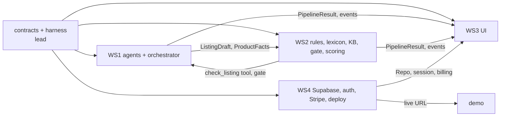

# Team guide — how five people (and their agents) build ShelfPass in parallel

Read this once, then read **your brief**:

| Workstream         | Branch prefix                             | Brief                                      | Owner        |
| ------------------ | ----------------------------------------- | ------------------------------------------ | ------------ |
| Lead / integration | `main`, `contract/*`, `chore/*`, `docs/*` | this guide + `docs/PRD.md`                 | heruis       |
| WS1 — AI pipeline  | `ws1/*`                                   | [ws1-ai-pipeline.md](./ws1-ai-pipeline.md) | _teammate 1_ |
| WS2 — Trust layer  | `ws2/*`                                   | [ws2-trust-layer.md](./ws2-trust-layer.md) | _teammate 2_ |
| WS3 — Product UI   | `ws3/*`                                   | [ws3-product-ui.md](./ws3-product-ui.md)   | _teammate 3_ |
| WS4 — Platform     | `ws4/*`                                   | [ws4-platform.md](./ws4-platform.md)       | _teammate 4_ |

(Lead: put names and GitHub usernames in this table and in `.github/CODEOWNERS`.)

## 1. Why this works without stepping on each other

1. **Contracts first.** Every shared type lives in `src/lib/contracts/` and is owned by the lead. You code against those types; nobody else changes them under you.
2. **Ports with zero-setup implementations.** The app runs end to end on day one in mock mode (mock agents, in-memory DB, mock billing). You replace _your_ stub with the real thing without waiting for anyone.
3. **Folder ownership.** `ownership.json` lists the folders each workstream may edit. A Claude Code hook blocks edits outside them on `ws*/` branches, and CI fails a PR that touches someone else's files. So two branches can never conflict, except for the lead's shared files.
4. **All dependencies are already installed.** `package.json` and the lockfile only change in `chore/` PRs by the lead. Need a package? Ask in your status file.

## 2. Day 1 checklist (everyone)

- [ ] Accept the GitHub invite; clone; `pnpm install`; follow `docs/SETUP.md` §1–2 (mock mode works).
- [ ] `pnpm check` and `pnpm eval` pass on your machine.
- [ ] Read `CLAUDE.md`, `docs/PRD.md` (15 min), `docs/ARCHITECTURE.md` and your brief.
- [ ] Set up the services your brief lists (SETUP.md §3–7). Run `pnpm check:env`.
- [ ] Create your first branch: `git switch -c ws<N>/<first-task>`.
- [ ] Start Claude Code with the **kickoff prompt** at the bottom of your brief.
- [ ] Before you stop for the day: `/handoff` (updates `docs/team/status/ws<N>.md`) and push your branch.

## 3. Git workflow

```
main ──●────────●───────────●──────── (always deployable, protected)
        \      / \         /
ws1/…    ●──●─●   \       /           one task per branch, small PRs
ws2/…              ●──●──●
contract/…    ●─●  (lead only: shared types)
```

- **Branch names:** `ws<N>/<short-task>`, e.g. `ws2/verify-kb-docs`, `ws4/supabase-repo`. One task (or one tight group of tasks) per branch.
- **Small PRs:** aim for < 400 changed lines. Merge often; long-lived branches rot.
- **Stay current:** run `/sync` (rebase on `origin/main`) at least daily and before opening a PR.
- **Pull request:** fill in the template; CI must be green (ownership, lint, types, tests, evals, build, e2e); one approving review (the lead or another workstream). **Squash merge.**
- **Never** push to `main` directly or force-push someone else's branch. (Lead: enable branch protection on `main`: require PR, 1 review, CI checks.)
- **Commits:** imperative and specific: `ws2: cite FDA doc for food-contact claims`.

### Running several Claude Code agents at once

Each agent session needs its own branch, and git allows one branch per working directory. Use worktrees:

```bash
git worktree add ../shelfpass-ws1-prompts -b ws1/extraction-prompt
git worktree add ../shelfpass-ws1-orch   -b ws1/orchestrator-retries
cd ../shelfpass-ws1-prompts && pnpm install && claude
```

The ownership hook reads each worktree's branch, so every parallel agent stays inside your workstream. Remove a worktree when merged: `git worktree remove ../shelfpass-ws1-prompts`.

## 4. Changing a file you do not own

| You need…                                      | Do this                                                                                                                                                                        |
| ---------------------------------------------- | ------------------------------------------------------------------------------------------------------------------------------------------------------------------------------ |
| A new field or type in `src/lib/contracts`     | Add a "Contract changes needed" line in your status file. The lead opens a `contract/*` PR (new fields are **optional first**, so nobody breaks), merges it, then you `/sync`. |
| A change in another workstream's folder        | Add it under "Requests for other workstreams" in your status file (exact file, change and why), and tell the owner. They own the fix.                                          |
| A new npm package                              | Ask the lead for a `chore/` PR.                                                                                                                                                |
| Something urgent at 2 a.m. before the deadline | Set `SHELFPASS_OWNERSHIP=off` for one session, make the minimal change, explain it in the PR. CI will still flag it, and the lead decides.                                     |

## 5. Who depends on whom



- WS1 and WS2 meet at the **contracts** (`ProductFacts`, `ListingDraft`, `ComplianceReport`) and at **`check_listing`** (WS1's tool calls WS2's validator and lexicon). Agree on prompt wording that mentions compliance in a short sync, not by editing each other's files.
- WS3 builds against the API response shapes and `PipelineEvent`s that exist today, in mock mode. It never waits for WS1, WS2 or WS4.
- WS4's `SupabaseRepo` must behave exactly like `MemoryRepo` (the executable spec). Until it merges, everyone uses `DATA_MODE=memory`.

## 6. Communication

- **Status files** (`docs/team/status/ws<N>.md`) are the shared task board. Update them with `/handoff` every day this week and whenever you are blocked. Short, structured, with file paths. No essays.
- **Standup** (async in chat, 3 lines): yesterday · today · blocked by.
- **Decisions** that change architecture or scope → `/decision` (writes `memory/decisions.md`) via a `docs/` PR to the lead.
- **Lessons** (something broke and you learned why) → one line in `memory/lessons-learned.md` (anyone may edit). These become the write-up's "lessons learned".

## 7. Definition of done (every task)

- [ ] Acceptance criteria in your brief are met and demonstrated (screenshot, test or eval output in the PR)
- [ ] `pnpm check` green; new behavior has tests next to the code
- [ ] Agent, rule or retrieval changes: `pnpm eval` before and after, pass rate in the PR
- [ ] No secrets; model output validated; user-scoped data access
- [ ] Status file updated

## 8. Shared deliverables

| Deliverable                                            | Owner                                                                  | Due         |
| ------------------------------------------------------ | ---------------------------------------------------------------------- | ----------- |
| Live URL + production checklist (`docs/DEPLOYMENT.md`) | WS4 with the lead                                                      | Day 2 (Tue) |
| Live eval run ≥ 80% recorded                           | WS2 runs, WS1 fixes prompts                                            | Day 4 (Thu) |
| Write-up ≤ 5 pages (`docs/report/WRITEUP.md`)          | Lead integrates; each WS writes its section in `docs/report/sections/` | Day 6 (Sat) |
| 3-minute demo (`docs/DEMO_SCRIPT.md`)                  | Lead drives; everyone rehearses twice                                  | Day 6 (Sat) |

The plan for the week is in `memory/timeline.md`. Feature freeze at the end of Day 4: after that, only fixes, tests, docs and demo polish.

## 9. Kickoff prompt template

Your brief ends with a ready-made version. The shape is:

> You are working on ShelfPass as **WS<N> (<name>)** on branch `ws<N>/<task>`. Read `CLAUDE.md`, `docs/team/TEAM_GUIDE.md` and `docs/team/ws<N>-<name>.md`. You may only edit the files `ownership.json` assigns to ws<N>; a hook enforces this. If you need a change elsewhere, write it into `docs/team/status/ws<N>.md` instead. Task: **<task id and title>**. First show me a short plan (files, steps, how you will verify). After I approve, implement in small steps, run `/check` after each, run `/eval` if you touched agents, rules or retrieval, and finish with `/handoff`.
